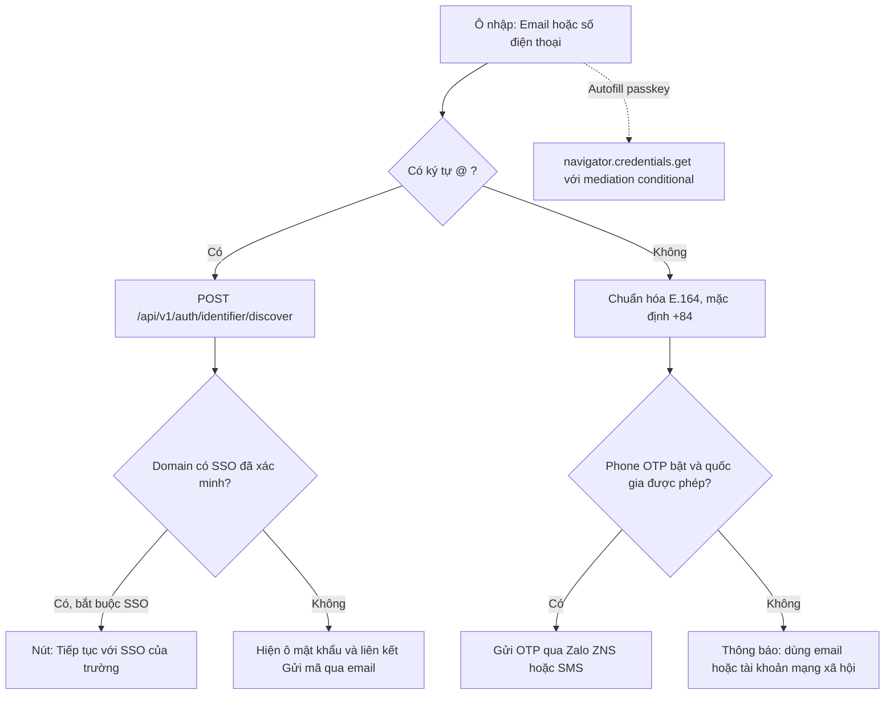
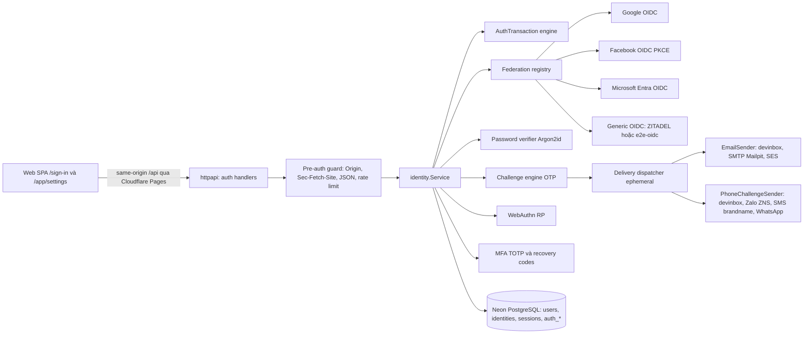
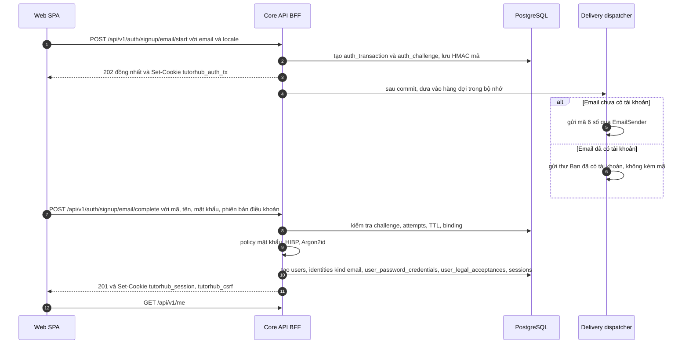
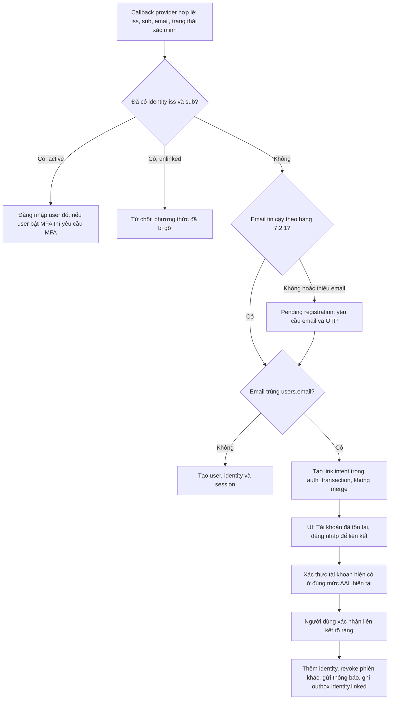
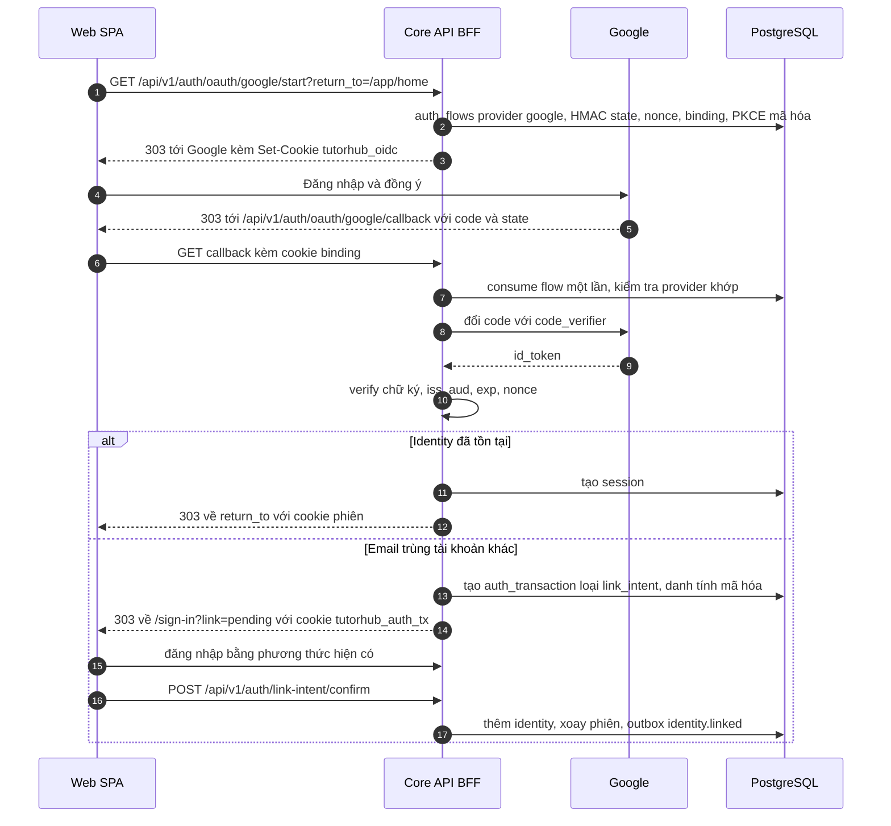
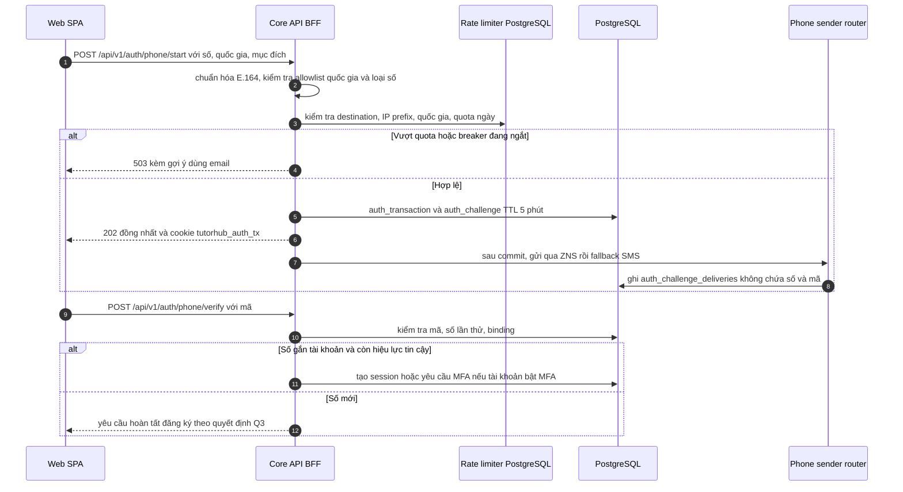
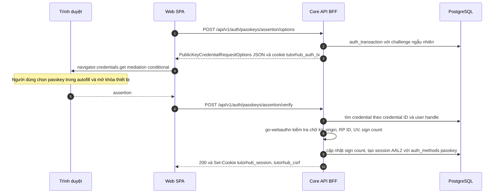
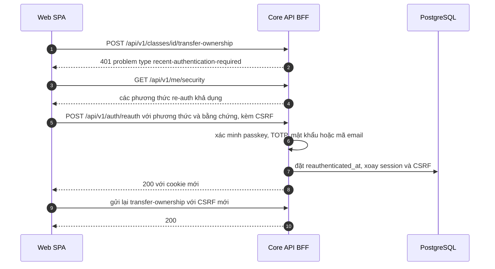
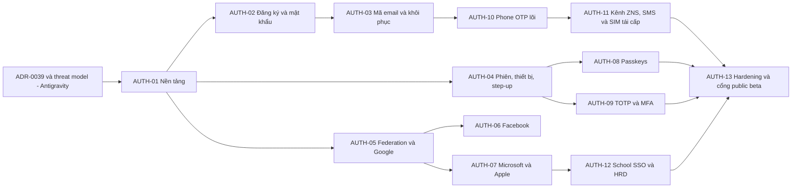

# AUTH-V2-00 — Nghiên cứu & Kế hoạch xác thực đa phương thức cho TutorHub V2

- Trạng thái: **Đã nghiệm thu & phê duyệt triển khai (Gatekeeper PASS, [ADR-0039](adr/0039-native-multi-method-authentication-and-federation.md) `Accepted` — 2026-11-16)**. Sẵn sàng thực thi từ `AUTH-01`.
- Ngày: 2026-11-16
- Người soạn: Claude Code (worker) theo prompt giao việc `AUTH-V2-00`
- Quyết định chủ dự án đã khóa (2026-11-16): (1) Chốt **Hướng 1** Native Go BFF Auth + Direct OAuth2/OIDC Federation và ngoại lệ gửi OTP ngắn hạn trực tiếp sau commit (`ADR-0039`); (2) Thứ tự triển khai `AUTH-01..03` (Email + Mật khẩu + OTP) → `AUTH-04` (Thiết bị/Step-up) → `AUTH-05..06` (Google & Facebook) → `AUTH-07..11` (Microsoft, Passkey, TOTP, Số điện thoại Zalo ZNS/SMS); (3) `PASSWORD_MIN_LENGTH=8` + chặn mật khẩu lộ HIBP, tích _"Duy trì đăng nhập"_ giữ phiên `30 ngày` cho học sinh/giáo viên (`24 giờ` cho `org_admin`); (4) Mọi tài khoản giai đoạn đầu giữ Email chuẩn (`users.email NOT NULL`), SĐT là phương thức đăng nhập/xác thực bổ sung ưu tiên Zalo ZNS trước SMS.
- Phạm vi: Email + mật khẩu, Email OTP/Magic Code, Google, Facebook, Microsoft/School SSO, Apple (tùy
  chọn), số điện thoại (SMS/Zalo ZNS/WhatsApp), Passkeys/WebAuthn, TOTP + mã khôi phục, step-up,
  liên kết nhiều phương thức và quản lý thiết bị/phiên.
- Tài liệu liên quan: [AUTHENTICATION.md](AUTHENTICATION.md), [SECURITY_BASELINE.md](SECURITY_BASELINE.md),
  [DATABASE.md](DATABASE.md), [ADR-0005](adr/0005-oidc-bff-session.md),
  [ADR-0008](adr/0008-zitadel-oidc-provider.md), [ADR-0018](adr/0018-postgresql-leased-outbox-worker.md),
  [ADR-0020](adr/0020-calendar-invitation-rsvp-icalendar-and-ses.md),
  [ADR-0038](adr/0038-antigravity-orchestrated-multi-agent-workflow.md).

---

## 0. Tóm tắt điều hành

**Kiến trúc đề xuất (thắng cuộc): Hướng 1 — Native first-party auth trong Go modular monolith
(`services/core-api/internal/modules/identity`) + federation OAuth2/OIDC trực tiếp từng nhà cung cấp**,
giữ nguyên mô hình BFF, cookie `__Host-tutorhub_session`/`__Host-tutorhub_csrf`, bảng
`tutorhub.sessions`/`tutorhub.identities` và fake issuer `e2e-oidc`. ZITADEL được hạ thành một
"generic OIDC provider" tùy chọn sau endpoint hiện có `GET /api/v1/auth/login`, không còn là điểm
phụ thuộc bắt buộc.

Lý do chính:

1. **Giữ 100% UI `/sign-in` custom** (UI-AUTH-01..03) — hosted login của IdP hoặc SDK UI của SaaS
   buộc thay đổi trải nghiệm hoặc thêm lớp token song song với BFF session.
2. **Chi phí gần 0 ở mọi quy mô** — chi phí biến đổi chỉ còn email/SMS/ZNS theo tin; không có phí
   MAU/DAU (ZITADEL Free chỉ 100 DAU; SaaS tính phí theo MAU khi vượt 25k–50k).
3. **Không thêm service stateful** trên Render Free (ADR-0011) — IdP tự host cần luôn bật, không
   chịu được cold start ~50 giây và Keycloak cần ~1,25 GB RAM/pod.
4. **Nền móng đã có sẵn và đúng chuẩn**: state/nonce/PKCE `S256`, browser binding, HMAC digest theo
   purpose, AES-GCM, recent-auth 10 phút, CSRF ba lớp, rate limiter PostgreSQL có signed edge context.
5. **Không vendor lock-in**: password hash (PHC Argon2id), passkey public key và session nằm trong
   Neon PostgreSQL của dự án.

Rủi ro lớn nhất của Hướng 1 là **gánh nặng tự triển khai bảo mật**. Kế hoạch giảm thiểu bằng: chỉ dùng
thư viện chuẩn đã kiểm chứng (không tự viết crypto), test matrix theo OWASP ASVS 5.0 L2 (V6/V7/V10),
NIST SP 800-63B-4 và RFC 9700, feature flag mặc định tắt, cùng pentest bên ngoài trước public beta.

**Hành động chặn trước khi code `AUTH-01`:** Antigravity cần ban hành **ADR-0039 (đề xuất)** thay thế
phần "Alternatives/Rejected" của ADR-0005 ("Tự xây email/password auth hoàn toàn: bị từ chối trong
MVP") và ADR-0008 ("Tự xây password/MFA: bị từ chối trong MVP"), cập nhật dòng đầu §2 của
`SECURITY_BASELINE.md`, và chốt ngoại lệ "OTP delivery không đi qua leased outbox" so với ADR-0018/0020
(§6.5). Danh sách quyết định của chủ dự án ở §13.

Lộ trình: 13 gói việc `AUTH-01` → `AUTH-13` (§11), ship dần sau feature flag cấp deployment, mặc
định **tắt**; thứ tự đề xuất: nền tảng → Email/Password/Email OTP → phiên/thiết bị/step-up → Google →
Facebook → Microsoft/School SSO → Passkeys → TOTP → Phone OTP.

---

## 1. Phương pháp, phạm vi và giới hạn

- Đã đọc toàn bộ tài liệu/mã nguồn bắt buộc của V2 trong prompt và 4 file V1 được phép (không mở
  file `.properties`, `.env*` hay bất kỳ file chứa secret nào).
- Benchmark sản phẩm và chuẩn bảo mật được tra cứu web ngày 2026-11-16. Nguồn chính thức (NIST,
  IETF, OWASP, Google, Microsoft, Meta, Slack, Notion) được ưu tiên; giá/hạn mức từ bên thứ ba được
  ghi rõ "cần xác minh" vì có thể đã thay đổi.
- Mọi tên file, bảng, cột, endpoint, cookie, env var hiện hữu được trích dẫn trong §2 đã được đối
  chiếu trực tiếp với mã nguồn tại commit `dc993735`.
- Tài liệu **không** phải tư vấn pháp lý. Các mục pháp lý Việt Nam (SMS brandname, dữ liệu cá nhân
  trẻ em) cần chủ dự án xác nhận với văn bản gốc trước khi vận hành thật.

---

## 2. Hiện trạng TutorHub V2 (đã đối chiếu mã nguồn)

### 2.1 Thành phần hiện có

| Thành phần                                                                                                        | Vai trò hiện tại                                                                                                                                                                                                                                                    |
| ----------------------------------------------------------------------------------------------------------------- | ------------------------------------------------------------------------------------------------------------------------------------------------------------------------------------------------------------------------------------------------------------------- |
| `services/core-api/internal/modules/identity/model.go`                                                            | `ProviderClaims`, interface `Provider` (1 provider), `Principal` (`AuthenticatedAt`, `IdentityID`), `ExternalIdentity`, `SessionMetadata`                                                                                                                           |
| `services/core-api/internal/modules/identity/service.go`                                                          | `BeginLogin`/`CompleteLogin`, `beginFlow`, `BeginIdentityLink`/`UnlinkIdentity`, `requireRecentAuthentication` (mặc định 10 phút), CSRF, logout                                                                                                                     |
| `services/core-api/internal/modules/identity/oidc_provider.go`                                                    | Adapter `coreos/go-oidc/v3` + `golang.org/x/oauth2`: PKCE `S256`, nonce, verify ID token rồi gọi UserInfo và bắt buộc `sub` khớp                                                                                                                                    |
| `services/core-api/internal/modules/identity/crypto.go`                                                           | `Digest(purpose, value)` HMAC-SHA256, `Encrypt/Decrypt` AES-GCM (key dẫn xuất `tutorhub-identity-aead-v1`), `IPPrefix` (/24, /56), `PKCEChallenge`                                                                                                                  |
| `services/core-api/internal/modules/identity/postgres_repository.go`                                              | `resolveIdentity` (advisory lock theo issuer/subject và email), `CreateAuthenticatedSession`, `GetSession` (idle refresh), `LinkIdentity`, `UnlinkIdentity`                                                                                                         |
| `services/core-api/internal/modules/identity/errors.go`                                                           | `ErrVerifiedEmailRequired`, `ErrIdentityLinkRequired`, `ErrLastIdentity`, `ErrIdentityInactive`, `ErrRecentAuthenticationRequired`, …                                                                                                                               |
| `services/core-api/internal/httpapi/auth.go`                                                                      | Handler login/callback/csrf/logout/me; cookie `tutorhub_session`, `tutorhub_csrf`, `tutorhub_oidc` (tiền tố `__Host-` khi `CookieSecure`)                                                                                                                           |
| `services/core-api/internal/httpapi/server.go`                                                                    | Route `/api/v1/auth/{login,callback,csrf,logout}`, `/api/v1/me`, `/api/v1/me/profile`, `/api/v1/me/identities`, `/api/v1/me/identities/link`                                                                                                                        |
| `services/core-api/internal/httpapi/postgres_invitation_rate_limiter.go`, `internal/platform/edgecontext/`        | Fixed-window limiter trên `tutorhub.rate_limit_windows`, client prefix ký bởi Cloudflare Pages (`EDGE_CONTEXT_SECRET`)                                                                                                                                              |
| `services/core-api/internal/platform/protecteddata/protector.go`                                                  | Mã hóa theo `Purpose` (ví dụ `invitation_recipient_address`) — tái dùng cho số điện thoại, TOTP secret                                                                                                                                                              |
| `services/core-api/internal/platform/e2eoidc/`, `services/core-api/cmd/e2e-oidc/main.go`, `scripts/e2e-local.mjs` | Fake OIDC issuer (discovery, JWKS, PKCE, UserInfo) chỉ chạy `APP_ENV=test` + loopback                                                                                                                                                                               |
| `services/core-api/internal/config/config.go`                                                                     | `AuthenticationConfig` (`IssuerURL`, `ClientID`, `SessionKey`, `CookieSecure`, `FlowTTL`, `SessionTTL`, `SessionAbsoluteTTL`, …)                                                                                                                                    |
| `apps/web/src/pages/SignInPage.tsx`                                                                               | UI đăng nhập/đăng ký/khôi phục: submit đăng nhập, nút social và nút hoàn tất của đăng ký/khôi phục đều gọi `onSignIn` → `GET /api/v1/auth/login`; dữ liệu form chỉ được kiểm tra phía client; OTP cooldown 60 giây, mật khẩu tối thiểu 8, state `identifier` sẵn có |
| `apps/web/src/pages/ProfileSettingsPage.tsx`, `apps/web/src/app/profile.ts`                                       | Danh sách identity, link/unlink (`useIdentitiesQuery`, `useBeginIdentityLink`, `useUnlinkIdentity`), xử lý lỗi cần xác thực lại                                                                                                                                     |
| `apps/web/src/app/session.tsx`                                                                                    | `SessionProvider`, `getLoginURL` → `GET /api/v1/auth/login`, logout qua `rotateCSRFToken` + `logout`                                                                                                                                                                |
| `openapi/tutorhub.yaml`, `packages/api-client/src/index.ts`                                                       | Contract `beginLogin`, `completeLogin`, `getCurrentUser`, `listIdentities`, `beginIdentityLink`, `unlinkIdentity`; schema `User` bắt buộc `email`                                                                                                                   |

### 2.2 Schema hiện hữu liên quan

| Bảng                          | Cột/ràng buộc chính (migration)                                                                                                                                                                                                                                                                           |
| ----------------------------- | --------------------------------------------------------------------------------------------------------------------------------------------------------------------------------------------------------------------------------------------------------------------------------------------------------- |
| `tutorhub.users`              | `id`, `email` NOT NULL (`users_email_normalized`, unique `users_email_unique_idx` trên `lower(email)`), `display_name`, `locale`, `timezone`, `status` (`active/suspended/deleted`) — `000001`; `avatar_object_key`, `avatar_metadata` — `000006`                                                         |
| `tutorhub.identities`         | `id`, `user_id`, `provider`, `subject`, `email_at_provider`, `identities_provider_subject_unique UNIQUE (provider, subject)` — `000001`; `email_verified`, `last_authenticated_at` — `000004`; `status` (`active/unlinked`), `unlinked_at` — `000006`                                                     |
| `tutorhub.sessions`           | `id`, `user_id`, `active_tenant_id`, `token_hash` (unique), `csrf_token_hash`, `user_agent_hash`, `ip_prefix` (`inet`), `created_at`, `last_seen_at`, `expires_at`, `revoked_at` — `000001`; `identity_id`, `absolute_expires_at`, `auth_time`, `revoked_reason` — `000004`; `context_version` — `000007` |
| `tutorhub.auth_flows`         | `state_hash` PK, `browser_binding_hash`, `nonce_hash`, `code_verifier_ciphertext`, `return_to` (`auth_flows_return_to_internal`), `expires_at`, `consumed_at` — `000004`; `purpose` (`login/identity_link`), `user_id`, `session_id` — `000006`                                                           |
| `tutorhub.rate_limit_windows` | `purpose` (regex `^[a-z][a-z0-9_]*(\.[a-z][a-z0-9_]*)*$`), `bucket_hash` (32 byte), `window_started_at`, `window_ends_at`, `used_count` — `000012`                                                                                                                                                        |
| `tutorhub.outbox_events`      | `tenant_id` (nullable), `aggregate_type`, `aggregate_id`, `event_type`, `payload` jsonb — `000003`; lease/dead-letter — `000015`. Identity đang phát `identity.linked`, `identity.unlinked`, `identity.profile.updated`                                                                                   |
| `tutorhub.audit_events`       | Append-only, trigger chặn update/delete — `000011`                                                                                                                                                                                                                                                        |

Migration mới nhất là `000042_private_alpha_enrollment`; migration AUTH đầu tiên dự kiến là `000043`.

### 2.3 Hành vi hiện hữu cần giữ nguyên

1. Flow OIDC một lần, tối đa 15 phút; DB chỉ lưu HMAC của state/binding/nonce và bản mã PKCE verifier.
2. Khóa identity là `(provider = issuer, subject)`; email đã xác minh chỉ dùng để **bootstrap user mới**.
   Nếu email đã thuộc user khác thì trả `ErrIdentityLinkRequired` — **không auto-merge** (đây chính là
   phòng thủ classic-federated merge, §3.4).
3. `ErrLastIdentity`: không cho gỡ phương thức đăng nhập cuối cùng.
4. Recent-auth 10 phút cho link/unlink và transfer ownership — nhưng hiện chưa phải step-up thật vì
   không ép `prompt`/`max_age` (ghi nhận trong `SECURITY_BASELINE.md`).
5. Session token/CSRF chỉ lưu keyed HMAC; idle 8 giờ, absolute 24 giờ; xoay token khi đổi context.
6. Accept membership invitation yêu cầu identity active có `email_verified=true` khớp email lời mời —
   các identity first-party mới (§8) phải thỏa điều kiện này để không phá luồng invitation.

### 2.4 Khoảng trống so với yêu cầu

| Yêu cầu                               | Hiện trạng                                                      | Khoảng trống                                                                |
| ------------------------------------- | --------------------------------------------------------------- | --------------------------------------------------------------------------- |
| Email + mật khẩu, đăng ký OTP         | UI có form, không có backend                                    | Credential store, Argon2id, policy, OTP engine, delivery, enumeration guard |
| Email OTP / magic code, quên mật khẩu | UI có form khôi phục (thông báo chuyển sang cổng IdP)           | Challenge engine, uniform response, reset revoke session                    |
| Google, Facebook, Microsoft, Apple    | 1 provider OIDC chung (`OIDC_ISSUER_URL`)                       | Provider registry, callback riêng, chính sách tin cậy email theo provider   |
| Số điện thoại                         | Không có                                                        | E.164, sender đa kênh, anti-pumping, quota, xử lý SIM tái cấp               |
| Passkeys, TOTP, step-up               | Không có; recent-auth dựa `auth_time` của IdP                   | WebAuthn, TOTP, recovery code, `reauthenticated_at`, assurance level        |
| Quản lý thiết bị/phiên                | `sessions` có `user_agent_hash`, `ip_prefix` nhưng không có API | Nhãn thiết bị thô, list/revoke/revoke-others                                |
| Account linking đầy đủ                | Link chỉ qua 1 provider; trùng email → lỗi cụt                  | Link intent có xác nhận, kiểm soát theo AAL                                 |

### 2.5 Ràng buộc tài liệu/ADR phải được Gatekeeper xử lý

| Văn bản                            | Nội dung xung đột                                                                  | Đề xuất                                                                            |
| ---------------------------------- | ---------------------------------------------------------------------------------- | ---------------------------------------------------------------------------------- |
| ADR-0005 §Alternatives             | "Tự xây email/password auth hoàn toàn: bị từ chối trong MVP"                       | ADR-0039 supersede đoạn này; giữ nguyên quyết định BFF + opaque session            |
| ADR-0008 §Alternatives             | "Tự xây password/MFA: bị từ chối trong MVP"; ZITADEL là IdP local/staging          | ADR-0039: ZITADEL thành provider OIDC tùy chọn; lộ trình gỡ bỏ có điều kiện        |
| `SECURITY_BASELINE.md` §2 dòng 1   | "không tự xây password protocol nếu có thể dùng IdP đáng tin cậy"                  | Thay bằng "first-party credential theo ASVS 5.0 L2/NIST 800-63B-4, thư viện chuẩn" |
| ADR-0018, ADR-0020                 | Side effect provider chỉ sau commit qua leased worker; chưa gửi email tới end user | Ngoại lệ có kiểm soát cho OTP (ephemeral, không durable) — §6.5                    |
| ADR-0007                           | Zero-cost alpha, không tự phát sinh phí                                            | Sender mặc định `devinbox`/`disabled`, quota cứng, ngân sách là quyết định §13     |
| ADR-0015 (feature controls tenant) | Control tenant-scoped, nhưng trước đăng nhập chưa có tenant                        | Flag cấp deployment `AUTH_*` (pre-tenant) + policy tenant cho MFA/SSO về sau       |
| `docs/AUTHENTICATION.md`           | Mô tả ZITADEL là IdP duy nhất                                                      | Cập nhật theo từng gói AUTH (không sửa trong AUTH-V2-00)                           |

---

## 3. Benchmark sản phẩm & UX

### 3.1 Bảng đối chiếu

| Sản phẩm                      | Mẫu nhập liệu                                                      | Phương thức chính                                                                             | SSO/HRD                                                                                      | Ghi chú rút ra cho TutorHub                                                                                           |
| ----------------------------- | ------------------------------------------------------------------ | --------------------------------------------------------------------------------------------- | -------------------------------------------------------------------------------------------- | --------------------------------------------------------------------------------------------------------------------- |
| Microsoft (MSA, Entra, Teams) | Identifier-first (một ô email/SĐT/Skype), bước 2 theo phương thức  | Từ 01/05/2025 tài khoản Microsoft mới mặc định **passwordless** (passkey, push, security key) | Entra Home Realm Discovery: domain liên kết chuyển thẳng tới IdP của tổ chức                 | Passkey-first giảm lỗi đăng nhập (Microsoft công bố 98% vs 32% thành công); ưu tiên phương thức người dùng đã đăng ký |
| Google / Google Meet          | Identifier-first, "Thử cách khác" khi không có phương thức ưu tiên | Mật khẩu, passkey, prompt điện thoại, SMS                                                     | Workspace: claim `hd` để xác định domain tổ chức                                             | Định danh bằng `sub`, không bằng email; chỉ tin email khi `email_verified` và Google là authoritative (`hd`)          |
| Zoom                          | Split form + nút social                                            | Email/mật khẩu, Google, Apple, Facebook, Microsoft, SSO                                       | SSO qua vanity domain hoặc nhập email để tìm domain công ty; trường có thể tắt social        | Cho phép tổ chức **ép SSO** và tắt phương thức consumer — cần cho trường học                                          |
| Slack                         | Identifier-first bằng email                                        | **Mã xác nhận qua email** (magic code), passkey; 2FA 6 số theo chính sách workspace           | Workspace/org yêu cầu SSO thì chuyển sang IdP; "Find your workspace" gửi danh sách qua email | Magic code thay magic link (dùng được khi email mở ở thiết bị khác); trả kết quả qua email để chống enumeration       |
| Notion                        | Identifier-first bằng email                                        | Mã qua email, email + mật khẩu, Google, Apple, passkey                                        | SAML SSO cần domain đã xác minh; có chế độ "require SAML" cho domain                         | Domain verification + chế độ ép SSO; passkey cho mọi gói                                                              |
| Zalo                          | Số điện thoại + mật khẩu                                           | SĐT/mật khẩu, xác thực bổ sung khi đăng nhập thiết bị lạ                                      | Không                                                                                        | Thiết bị lạ = điểm kích hoạt step-up                                                                                  |
| Shopee (VN)                   | Ô "Email/SĐT/Tên đăng nhập" + tab đăng nhập bằng SMS               | Mật khẩu hoặc OTP; OTP gửi qua **SMS, Zalo hoặc cuộc gọi tự động**; yêu cầu số hợp lệ tại VN  | Không                                                                                        | Đa kênh OTP (Zalo trước SMS) là kỳ vọng phổ biến của người dùng Việt Nam                                              |

Nguồn: §14 (Microsoft, Slack, Notion, Google, Zoom, Shopee, Zalo). Hành vi UI chi tiết của Microsoft/
Google (thứ tự bước, "Thử cách khác") là quan sát thực hành phổ biến, cần chụp lại màn hình khi thiết kế.

### 3.2 Identifier-first vs Split form — khuyến nghị cho `/sign-in`

| Tiêu chí                         | Split form (hiện tại)               | Identifier-first / Unified                                                                  |
| -------------------------------- | ----------------------------------- | ------------------------------------------------------------------------------------------- |
| Số phương thức hiển thị cùng lúc | Nhiều, rối khi thêm SĐT/passkey/SSO | Một ô, bước 2 thích ứng                                                                     |
| HRD trường học                   | Không làm được                      | Tự nhận diện `@truong.edu.vn` và chuyển SSO                                                 |
| Passkey autofill                 | Có thể (ô email)                    | Tự nhiên nhất (`autocomplete="username webauthn"`)                                          |
| Enumeration                      | Thấp                                | Rủi ro nếu bước 2 khác nhau theo user — phải chỉ phụ thuộc **domain**, không phụ thuộc user |
| Thay đổi UI                      | 0                                   | Vừa phải; `LoginForm` đã dùng state `identifier`                                            |

**Khuyến nghị: "Hybrid identifier-first" giữ bố cục UI-AUTH-01..03.** Ô đầu tiên đổi nhãn thành "Email
hoặc số điện thoại"; nút social vẫn hiển thị bên dưới; tab Đăng ký giữ nguyên. Bước 2 chỉ phụ thuộc
loại định danh và chính sách domain, không bao giờ phụ thuộc việc tài khoản có tồn tại hay không.



Quy tắc nhận diện phía web (server luôn xác thực lại): chứa `@` → email; chỉ gồm `+`, chữ số, khoảng
trắng, `.`, `-`, `(`, `)` và có ít nhất 8 chữ số → số điện thoại; còn lại → lỗi định dạng.

### 3.3 Home Realm Discovery (HRD) cho trường học/tổ chức

- Discovery chỉ trả về thông tin **cấp domain** (`sso_required`, tên hiển thị kết nối), giống Slack/Notion;
  không trả "tài khoản tồn tại" hay "phương thức user đã bật".
- Domain chỉ được gắn SSO sau khi `org_admin` chứng minh sở hữu qua DNS TXT (mẫu Notion).
- Với Google Workspace: tham số `hd` chỉ là gợi ý UI; server **bắt buộc** kiểm tra claim `hd` trong
  ID token. Với Microsoft Entra: kiểm tra `tid` thuộc danh sách tenant đã gắn với kết nối.
- Chế độ `enforce_sso`: email thuộc domain chỉ được đăng nhập bằng SSO (tắt mật khẩu/OTP), học Zoom/Notion.

### 3.4 Trùng email/SĐT giữa các phương thức & Pre-Account Takeover

Nghiên cứu "Pre-hijacked accounts" (Sudhodanan & Paverd, USENIX Security 2022) tìm thấy 56 lỗ hổng
trên 35/75 dịch vụ phổ biến với 5 lớp tấn công. Ánh xạ sang TutorHub:

| Lớp tấn công            | Cơ chế                                                                                        | Kiểm soát của TutorHub                                                                                                                           |
| ----------------------- | --------------------------------------------------------------------------------------------- | ------------------------------------------------------------------------------------------------------------------------------------------------ |
| Classic-federated merge | Kẻ tấn công tạo tài khoản mật khẩu bằng email nạn nhân; nạn nhân sau đó login Google → bị gộp | (1) Đăng ký mật khẩu **chỉ tạo user sau khi xác minh OTP email**; (2) federated trùng email **không auto-merge** (giữ `ErrIdentityLinkRequired`) |
| Unexpired session       | Kẻ tấn công giữ phiên cũ sau khi nạn nhân reset mật khẩu                                      | Reset/đổi mật khẩu, thêm/gỡ phương thức, bật MFA → **revoke mọi phiên khác** và xoay phiên hiện tại                                              |
| Trojan identifier       | Kẻ tấn công gắn sẵn SĐT/IdP của mình vào tài khoản dùng email nạn nhân                        | Không tạo được tài khoản chưa xác minh email; sau khôi phục hiển thị danh sách phương thức để rà soát; thêm phương thức yêu cầu step-up          |
| Unexpired email change  | Token đổi email cũ vẫn dùng được                                                              | Token đổi email TTL 15 phút, một lần, vô hiệu khi có thay đổi khác; thông báo email cũ                                                           |
| Non-verifying IdP       | IdP cho phép email chưa xác minh                                                              | Bảng tin cậy email theo provider (§7.2.1); Facebook và Microsoft thiếu `xms_edov` bị coi là chưa xác minh                                        |

**Nguyên tắc liên kết (account linking):** chỉ liên kết khi người dùng **chứng minh kiểm soát cả hai
phía tại thời điểm liên kết** — phía hiện có phải xác thực ở đúng mức bảo đảm hiện tại của tài khoản
(nếu đã bật MFA thì phải qua MFA). Không bao giờ liên kết chỉ vì trùng chuỗi email/SĐT. Chi tiết state
machine ở §7.2.6.

### 3.5 Rủi ro số điện thoại bị thu hồi/cấp lại (Recycled Phone Number)

- Nghiên cứu Princeton (Lee & Narayanan, 2021): 171/259 số được cấp lại cho thuê bao mới tại hai nhà
  mạng Mỹ vẫn gắn với tài khoản trực tuyến; một phần gắn với mật khẩu đã lộ, đủ để vượt SMS 2FA.
- Tại Việt Nam, thuê bao bị khóa một/hai chiều (hết hạn, chưa xác thực chính chủ, đổi thiết bị không
  xác thực lại) có thể bị thanh lý và thu hồi số; mốc thời gian giữ số theo các nguồn bán lẻ là vài chục
  ngày (cần xác nhận với thông báo chính thức của nhà mạng). Số thu hồi có thể được cấp cho người khác.
- Không có API SIM-swap/recycle công khai đáng tin cậy tại VN → **không** dựa vào tín hiệu nhà mạng.

Kiểm soát đề xuất (chi tiết §7.3.6): SĐT là **định danh có thời hạn tin cậy**; quyền "gộp/claim SĐT"
tách khỏi quyền "khôi phục tài khoản"; tài khoản có MFA không bao giờ khôi phục chỉ bằng SMS; số không
được dùng/xác minh lại quá ngưỡng bị hạ quyền khôi phục; chủ mới của số có thể claim số nhưng **không
bao giờ** vào được tài khoản cũ.

### 3.6 UX: đăng ký, quên mật khẩu, step-up, quản lý thiết bị

| Tình huống         | Mẫu đề xuất (theo Slack/Notion/Google/Microsoft)                                                                                                                                               |
| ------------------ | ---------------------------------------------------------------------------------------------------------------------------------------------------------------------------------------------- |
| Đăng ký            | Nhập tên + email → "Gửi mã" (cooldown 60 giây như UI hiện tại) → nhập mã + mật khẩu + đồng ý điều khoản. Email đã có tài khoản nhận thư "Bạn đã có tài khoản" thay vì mã; UI không phân biệt.  |
| Đăng nhập          | Passkey autofill ngay khi focus; mật khẩu; "Gửi mã đăng nhập qua email"; nút Google/Facebook/Microsoft; SĐT khi bật.                                                                           |
| Quên mật khẩu      | Thông điệp thống nhất "Nếu email đã đăng ký, mã sẽ được gửi"; nhập mã + mật khẩu mới; nếu bật MFA thì phải qua MFA; sau đổi: revoke phiên khác + email thông báo.                              |
| Step-up            | Hộp thoại "Xác nhận đó là bạn" ưu tiên passkey → TOTP → mật khẩu → mã email; hiệu lực 10 phút (khớp `defaultRecentAuthTTL`).                                                                   |
| Thiết bị/phiên     | Trang `/app/settings` mục "Thiết bị đang đăng nhập": nhãn thô (trình duyệt · hệ điều hành), lần hoạt động cuối, "Phiên này", nút "Đăng xuất" từng phiên và "Đăng xuất khỏi các thiết bị khác". |
| Trình duyệt in-app | Link chia sẻ qua Zalo/Facebook thường mở trong webview in-app; Google chặn OAuth trong embedded webview và passkey kém ổn định → phát hiện và gợi ý "Mở bằng trình duyệt".                     |
| Accessibility/i18n | Ô OTP `autocomplete="one-time-code"`, `inputmode="numeric"`; thông báo lỗi `aria-live`; mọi chuỗi `vi`/`en`; focus quay về trường lỗi đầu tiên (theo mẫu hiện có của `SignUpForm`).            |

---

## 4. Chuẩn bảo mật áp dụng → yêu cầu thiết kế

| Chuẩn                                      | Yêu cầu chính (rút gọn)                                                                                                                                                           | Áp dụng trong kế hoạch                                                                                        |
| ------------------------------------------ | --------------------------------------------------------------------------------------------------------------------------------------------------------------------------------- | ------------------------------------------------------------------------------------------------------------- |
| NIST SP 800-63B-4 (final 07/2025)          | Mật khẩu dùng làm yếu tố đơn: **tối thiểu 15 ký tự**; khi là một phần MFA: tối thiểu 8; không quy tắc thành phần; kiểm tra blocklist; rate-limit thất bại theo tài khoản (§3.2.2) | Policy cấu hình được, mặc định theo quyết định §13-Q4; blocklist + HIBP; throttle theo tài khoản              |
| NIST SP 800-63B (out-of-band)              | SMS/PSTN là authenticator bị hạn chế (restricted); email **không** được dùng làm authenticator out-of-band (đối chiếu điều khoản cụ thể của 63B-4 khi viết ADR-0039)              | Email code chỉ là phương thức đăng nhập AAL1 tiện dụng, không tính là yếu tố MFA; SMS không phải MFA mặc định |
| OWASP ASVS 5.0 V6 (Authentication)         | Độ dài/blocklist mật khẩu, chống brute force, khôi phục an toàn, MFA, không tiết lộ tồn tại tài khoản                                                                             | §6.6, §6.7, §7.1                                                                                              |
| OWASP ASVS 5.0 V7 (Session Management)     | Token ngẫu nhiên đủ entropy, timeout, revoke, xác thực lại trước thao tác nhạy cảm, xem/đăng xuất phiên khác                                                                      | §6.8, §7.6, §7.7                                                                                              |
| OWASP ASVS 5.0 V10 (OAuth & OIDC)          | Client: PKCE, state, nonce, xác minh ID token, chống mix-up, chỉ tin claim đã xác minh                                                                                            | §7.2                                                                                                          |
| OWASP ASVS 4.0.3 V2/V3                     | Tương ứng V6/V7 của 5.0 (prompt yêu cầu đối chiếu)                                                                                                                                | Exit gate mỗi gói (§11.3) lập test matrix theo mã yêu cầu của cả 4.0.3 và 5.0                                 |
| RFC 9700 (OAuth 2.0 Security BCP, 01/2025) | Authorization Code + PKCE; exact redirect URI; chống mix-up (redirect URI riêng từng AS hoặc tham số `iss` RFC 9207); không implicit/ROPC                                         | Callback riêng từng provider, `auth_flows.provider` bắt buộc khớp, kiểm tra `iss` khi provider hỗ trợ         |
| OWASP Password Storage Cheat Sheet         | Argon2id tối thiểu m=19 MiB, t=2, p=1 (hoặc cấu hình tương đương)                                                                                                                 | §7.1.1                                                                                                        |
| OWASP Forgot Password / Authentication CS  | Phản hồi đồng nhất, token một lần có hạn, không bypass MFA khi khôi phục                                                                                                          | §7.1.4                                                                                                        |
| WebAuthn Level 3 / passkey guidance        | Discoverable credential, conditional mediation, Signal API                                                                                                                        | §7.4                                                                                                          |

---

## 5. Ba hướng kiến trúc & Ma trận quyết định

### 5.1 Mô tả

1. **Hướng 1 — Native first-party auth + direct federation trong Go modular monolith.** Mở rộng
   `modules/identity`: Argon2id, OTP engine, provider registry (Google/Facebook/Microsoft/Apple/OIDC
   chung), WebAuthn, TOTP; BFF session PostgreSQL giữ nguyên.
2. **Hướng 2 — Self-hosted/headless OSS engine** (Ory Kratos, ZITADEL self-host, Keycloak, SuperTokens
   core, Better Auth). Biến thể **2b**: tiếp tục ZITADEL Cloud nhưng dùng **Session API** để giữ UI custom.
3. **Hướng 3 — Managed SaaS** (Clerk, Auth0, Supabase Auth, Firebase Auth/Identity Platform).

### 5.2 Chi phí ước tính (MAU/DAU, chưa gồm SMS/email)

| Phương án                  | Alpha (≤100 người)             | 10k học sinh                | 100k học sinh                                                    | Nguồn/độ tin cậy                  |
| -------------------------- | ------------------------------ | --------------------------- | ---------------------------------------------------------------- | --------------------------------- |
| Hướng 1 (native)           | 0 USD                          | 0 USD (compute sẵn có)      | 0 USD phí auth; có thể cần nâng instance cho Argon2id            | Tự tính                           |
| ZITADEL Cloud (2b)         | Free: 100 DAU, 3 IdP           | Pro 100 USD/tháng (25k DAU) | Pro + phí vượt DAU (bên thứ ba: 50 USD/2.500 DAU, chưa xác minh) | Trang giá chính thức + bên thứ ba |
| Supabase Auth              | Free 50k MAU                   | Free                        | Pro 25 USD/tháng gồm 100k MAU                                    | Bên thứ ba, cần xác minh          |
| Firebase/Identity Platform | Free                           | Free (≤50k MAU)             | ~0,0055 USD/MAU vượt 50k                                         | Bên thứ ba, cần xác minh          |
| Clerk                      | Free (nguồn mâu thuẫn 10k/50k) | Free                        | 25 USD + 0,02 USD/user từ 50k–100k                               | Bên thứ ba, mâu thuẫn             |
| Auth0                      | Free 25k MAU (MFA hạn chế)     | Free                        | Không công bố giá công khai trên ~30k                            | Bên thứ ba                        |
| Keycloak self-host         | Cần instance ≥1,25 GB RAM      | Như alpha + DB/backup       | Cluster + vận hành                                               | Keycloak sizing guide chính thức  |

Chi phí biến đổi chung cho mọi phương án (§7.3.3): email ~0,10 USD/1.000 thư (SES), Zalo ZNS OTP
~250–330 VND/tin, SMS brandname ~600–1.000 VND/tin (giá đại lý, cần báo giá chính thức).
Ví dụ 100k học sinh × 0,3 OTP điện thoại/tháng ≈ 30.000 tin ≈ 9 triệu VND/tháng (ZNS) hoặc ≈ 24
triệu VND/tháng (SMS) — vì vậy OTP điện thoại phải dùng tiết kiệm (đăng ký/khôi phục/thiết bị lạ),
không dùng cho mỗi lần đăng nhập.

### 5.3 Ma trận quyết định có trọng số (1 = kém, 5 = tốt)

| Tiêu chí (trọng số)                    | H1 Native | H2 Self-host OSS | H2b ZITADEL Session API | H3 Managed SaaS |
| -------------------------------------- | :-------: | :--------------: | :---------------------: | :-------------: |
| Chi phí alpha 0 USD (10%)              |     5     |        2         |            4            |        5        |
| Chi phí ở 10k–100k (20%)               |     5     |        4         |            2            |        2        |
| Giữ nguyên UI `/sign-in` custom (15%)  |     5     |        4         |            4            |        3        |
| Độ đơn giản vận hành Render/Neon (15%) |     4     |        1         |            4            |        5        |
| Bảo mật/độ chín (20%)                  |     3     |        4         |            4            |        4        |
| Không vendor lock-in (10%)             |     5     |        4         |            2            |        1        |
| Thời gian ra sản phẩm (10%)            |     2     |        3         |            3            |        4        |
| **Điểm có trọng số**                   | **4,15**  |     **3,25**     |        **3,30**         |    **3,40**     |

Giải thích điểm yếu của từng hướng:

- **H2 (self-host):** cần thêm service luôn bật + schema/DB riêng + courier email/SMS riêng; Render Free
  spin-down không chấp nhận được cho IdP; Keycloak ~1,25 GB RAM/pod; ZITADEL chuyển core sang
  **AGPL-3.0 từ v3 (2025)** (Cloud không bị ảnh hưởng) nên self-host có sửa đổi cần rà soát pháp lý;
  SuperTokens tách `ee/` (MFA, multi-tenancy) sang giấy phép thương mại; Better Auth là thư viện
  TypeScript, không chạy trong Go monolith.
- **H2b (ZITADEL Session API):** giữ được UI nhưng hai nguồn sự thật cho user/credential, kênh Zalo/SMS
  VN phụ thuộc nhà cung cấp, Free chỉ 100 DAU — vượt ngay khi mở 1 trường; lock-in hash mật khẩu.
- **H3 (SaaS):** mỗi SaaS phát session/JWT riêng → BFF phải đổi token và duy trì hai lớp phiên (xung đột
  ADR-0005); dữ liệu học sinh nằm ở bên thứ ba (đánh giá chuyển dữ liệu xuyên biên giới theo Luật
  BVDLCN 2025); chi phí tăng mạnh từ 50k MAU; xuất hash mật khẩu phụ thuộc chính sách nhà cung cấp.
- **H1:** điểm bảo mật thấp nhất vì tự triển khai; bù bằng phạm vi thư viện chuẩn, test matrix và
  pentest (§11 `AUTH-13`). Đây là rủi ro chính cần Gatekeeper chấp nhận.

### 5.4 Kết luận

**Chọn Hướng 1.** Điều kiện xem lại (exit trigger) ghi vào ADR-0039: (a) cần SAML/SCIM doanh nghiệp
diện rộng; (b) pentest phát hiện lỗi Critical lặp lại trong lớp credential; (c) chi phí vận hành bảo
mật (patch, on-call) vượt khả năng nhóm. Khi đó cân nhắc ZITADEL Cloud Pro/Session API hoặc Kratos qua
cùng interface `Provider`/`CredentialVerifier` để không đổi contract browser.

### 5.5 Học gì từ mã nguồn mở (không chạy thêm service)

| Dự án                         | Mẫu nên học                                                                                                                                                             | Áp dụng                                                                    |
| ----------------------------- | ----------------------------------------------------------------------------------------------------------------------------------------------------------------------- | -------------------------------------------------------------------------- |
| Ory Kratos (Apache-2.0)       | "Self-service flow" có id, TTL, state machine (login/registration/recovery/verification/settings); `privileged_session_max_age`; credentials theo loại gắn vào identity | Bảng `auth_transactions` + `identities.kind`; recent-auth theo phương thức |
| ZITADEL Session API           | Session gom nhiều "check" (user, password, passkey, TOTP, IdP intent), mỗi check nâng mức bảo đảm                                                                       | `sessions.auth_methods` + `assurance_level`, xác thực từng bước            |
| Better Auth (MIT)             | Bảng `account` (provider + accountId), `verification` (identifier, value, expiresAt), rate-limit table                                                                  | Tách challenge khỏi credential; mỗi challenge một mục đích                 |
| SuperTokens (core Apache-2.0) | Account linking chỉ khi cả hai phía email đã xác minh; "primary user" và "recipe user"                                                                                  | Quy tắc liên kết §7.2.6                                                    |
| Keycloak (Apache-2.0)         | "First broker login" flow: khi IdP trả email trùng → xác minh tài khoản hiện có trước khi liên kết                                                                      | Link intent có xác nhận                                                    |

### 5.6 Thư viện Go/TS được đề xuất

| Thư viện                                     | Mục đích                         | Giấy phép                     | Hiện trạng trong repo / bảo trì                            | Quyết định                                                                                 |
| -------------------------------------------- | -------------------------------- | ----------------------------- | ---------------------------------------------------------- | ------------------------------------------------------------------------------------------ |
| `golang.org/x/crypto/argon2`                 | Argon2id                         | BSD-3-Clause                  | `golang.org/x/crypto v0.55.0` đang là dependency gián tiếp | Dùng `argon2.IDKey`, chuyển thành direct dependency                                        |
| `github.com/coreos/go-oidc/v3`               | Discovery, JWKS, verify ID token | Apache-2.0                    | `v3.20.0` đang dùng                                        | Giữ; Entra multi-tenant cần kiểm tra issuer theo `tid` thủ công                            |
| `golang.org/x/oauth2`                        | Authorization Code + PKCE        | BSD-3-Clause                  | `v0.36.0` đang dùng                                        | Giữ                                                                                        |
| `github.com/go-webauthn/webauthn`            | WebAuthn RP                      | BSD-3-Clause                  | Hoạt động (dòng v0.1x; chốt phiên bản khi thêm)            | Dùng; tránh các fork không đầy đủ Level 3                                                  |
| `github.com/nyaruka/phonenumbers`            | E.164, loại số, vùng             | MIT (metadata gốc Apache-2.0) | Port của libphonenumber, cập nhật metadata thường xuyên    | Dùng phía server (nguồn sự thật)                                                           |
| `github.com/pquerna/otp`                     | TOTP RFC 6238                    | Apache-2.0                    | v1.5.0 (12/2024), ổn định                                  | Dùng; tự thêm chống replay theo time-step                                                  |
| `github.com/aws/aws-sdk-go-v2/service/sesv2` | Email SES                        | Apache-2.0                    | `v1.66.0` đã có (ADR-0020)                                 | Tái dùng adapter                                                                           |
| `libphonenumber-js` (web)                    | Định dạng khi gõ                 | MIT                           | Cần Gatekeeper duyệt dependency                            | Tùy chọn; server vẫn quyết định                                                            |
| `@simplewebauthn/browser` (web)              | Chuyển đổi base64url/JSON        | MIT                           | Cần duyệt dependency                                       | Tùy chọn; ưu tiên `PublicKeyCredential.parseRequestOptionsFromJSON` khi trình duyệt hỗ trợ |
| Mailpit (công cụ local)                      | SMTP sink + web UI               | MIT                           | Chạy container local                                       | Chỉ local/E2E                                                                              |

---

## 6. Kiến trúc mục tiêu & nền tảng chung

### 6.1 Sơ đồ thành phần



Bố cục mã đề xuất (vẫn một module `identity`, không tách microservice):

```text
services/core-api/internal/modules/identity/
  password.go            # Argon2id PHC, policy, blocklist, rehash
  password_breach.go     # HIBP range client (timeout, padding), offline blocklist
  transaction.go         # auth_transactions state machine
  challenge.go           # OTP sinh/kiểm tra/resend/cooldown
  delivery.go            # interface EmailSender, PhoneChallengeSender, dispatcher
  federation_registry.go # Provider theo slug, chính sách tin cậy email
  provider_google.go, provider_facebook.go, provider_microsoft.go, provider_apple.go
  webauthn.go, mfa_totp.go, recovery_codes.go
  linking.go             # link intent + quy tắc liên kết
  session_devices.go     # nhãn thiết bị, list/revoke
services/core-api/internal/platform/devinbox/   # hộp thư dev/test cho OTP (loopback, APP_ENV local/test)
services/core-api/internal/platform/phone/      # chuẩn hóa E.164 bọc nyaruka/phonenumbers
```

### 6.2 Feature flags (cấp deployment, mặc định tắt)

Trước đăng nhập chưa có tenant nên **không** dùng tenant feature controls (ADR-0015). Đề xuất env:

| Flag                                                                                     | Mặc định                                           | Ghi chú                                                                                                       |
| ---------------------------------------------------------------------------------------- | -------------------------------------------------- | ------------------------------------------------------------------------------------------------------------- |
| `AUTH_SIGNUP_ENABLED`                                                                    | `false`                                            | Cho phép tạo tài khoản first-party                                                                            |
| `AUTH_METHOD_PASSWORD_ENABLED`                                                           | `false`                                            | Đăng nhập email + mật khẩu                                                                                    |
| `AUTH_METHOD_EMAIL_CODE_ENABLED`                                                         | `false`                                            | Đăng nhập bằng mã email, khôi phục mật khẩu                                                                   |
| `AUTH_PROVIDER_GOOGLE_ENABLED`, `..._FACEBOOK_...`, `..._MICROSOFT_...`, `..._APPLE_...` | `false`                                            | Mỗi provider có bộ biến `CLIENT_ID`/`CLIENT_SECRET`/`CALLBACK_URL` riêng, fail-fast nếu thiếu                 |
| `AUTH_PROVIDER_OIDC_DEFAULT_ENABLED`                                                     | `true`                                             | Giữ `/api/v1/auth/login` (ZITADEL/e2e-oidc) — tương thích ngược                                               |
| `AUTH_METHOD_PHONE_ENABLED`, `AUTH_PHONE_ALLOWED_COUNTRIES`                              | `false`, `VN`                                      | Phone OTP và allowlist mã quốc gia                                                                            |
| `AUTH_PASSKEYS_ENABLED`, `AUTH_MFA_TOTP_ENABLED`                                         | `false`                                            |                                                                                                               |
| `AUTH_SSO_DOMAINS_ENABLED`, `AUTH_DEVICE_MANAGEMENT_ENABLED`                             | `false`                                            |                                                                                                               |
| `AUTH_EMAIL_SENDER`, `AUTH_PHONE_SENDER`                                                 | `devinbox` (local/test), `disabled` (staging/prod) | Giá trị trả phí (`ses`, `zns`, `sms_brandname`, `twilio`) chỉ hợp lệ khi `AUTH_DELIVERY_BUDGET_APPROVED=true` |
| `AUTH_EMAIL_DAILY_QUOTA`, `AUTH_PHONE_OTP_DAILY_QUOTA`                                   | 200, 50                                            | Quota cứng trong PostgreSQL, thấp hơn quota nhà cung cấp (ADR-0007)                                           |

`GET /api/v1/auth/providers` trả danh sách phương thức đang bật để UI ẩn/hiện nút — server là nguồn sự
thật, UI không tự quyết. Đề xuất thêm guard CI (file mới, chưa tồn tại) `scripts/check-auth-delivery-guard.mjs`
theo mẫu các script force-off hiện có, chặn cấu hình sender trả phí ở staging khi chưa có cờ ngân sách.

### 6.3 Auth transaction & bảo vệ request trước đăng nhập

- Mỗi luồng chưa có session (đăng ký, đăng nhập nhiều bước, khôi phục, MFA, link intent, re-auth) là
  một hàng `tutorhub.auth_transactions` gắn với cookie mới `__Host-tutorhub_auth_tx` (`HttpOnly`,
  `Secure`, `SameSite=Strict`, `Path=/`, TTL ≤ 15 phút; khi `CookieSecure=false` dùng tên không tiền tố
  như quy ước hiện tại). DB chỉ lưu `Digest("auth-tx-binding", value)`.
- Không tái dùng cookie `tutorhub_oidc` để không ảnh hưởng flow OIDC hiện có.
- Mọi `POST /api/v1/auth/*` chưa có session: bắt buộc `Content-Type: application/json`, `Origin` khớp
  `WebOrigin`, `Sec-Fetch-Site` là `same-origin` (nếu có) — chống login CSRF; strict JSON decoder như
  P2-10; phản hồi `Cache-Control: no-store`, `Referrer-Policy: no-referrer`.
- Hoàn tất xác thực luôn **phát session token mới** (chống session fixation), consume transaction một lần.

### 6.4 Challenge engine (OTP/magic code)

| Tham số          | Giá trị đề xuất                                                                         | Căn cứ                                                          |
| ---------------- | --------------------------------------------------------------------------------------- | --------------------------------------------------------------- |
| Định dạng        | 6 chữ số từ CSPRNG (`crypto/rand`), không dùng `math/rand`                              | V1 `OtpService` dùng `SecureRandom`; V1 legacy `Random` bị loại |
| Lưu trữ          | `code_hash = Digest("auth-otp-v1", challenge_id + ":" + code)`; **không lưu plaintext** | Mẫu HMAC theo purpose của `crypto.go`                           |
| TTL              | Email 10 phút; SMS/ZNS 5 phút                                                           | V1 10 phút; SMS ngắn hơn do chi phí và rủi ro                   |
| Thử sai tối đa   | 5 lần/challenge, sau đó challenge bị vô hiệu                                            | V1 max 5                                                        |
| Cooldown gửi lại | 60 giây (khớp `OTP_COOLDOWN_SECONDS` của UI), tối đa 5 lần gửi/transaction              | V1 cooldown 60 giây                                             |
| Gửi lại          | Mỗi lần gửi tạo mã mới, vô hiệu mã cũ                                                   | Tránh nhiều mã cùng hợp lệ                                      |
| Gắn kết          | Challenge thuộc transaction (cookie) — mã lấy từ trình duyệt khác không dùng được       | Giảm relay/phishing                                             |
| Chống timing     | So sánh `subtle.ConstantTimeCompare`; mọi nhánh cùng thao tác DB                        | ASVS V6                                                         |

Magic **code** được chọn thay magic **link**: link bị bộ quét email tự mở, khó dùng khi email mở trên
thiết bị khác (học Slack). Có thể bổ sung link dạng `/sign-in/verify#code=...` (fragment, như invitation)
ở gói sau.

### 6.5 Delivery: dispatcher ephemeral, dev inbox, Mailpit, SES

```go
type DeliveryChannel string // "email", "zalo_zns", "sms", "whatsapp", "voice"

type ChallengeMessage struct {
    ChallengeID uuid.UUID
    Purpose     string // signup_email, login_code, password_recovery, phone_login, ...
    Destination string // email chuẩn hóa hoặc E.164; chỉ tồn tại trong bộ nhớ
    Code        string // chỉ tồn tại trong bộ nhớ, không log
    Locale      string
    ExpiresAt   time.Time
}

type EmailSender interface {
    SendChallenge(ctx context.Context, message ChallengeMessage) (DeliveryReceipt, error)
    SendNotice(ctx context.Context, notice AccountNotice) (DeliveryReceipt, error) // "đã có tài khoản", "mật khẩu đã đổi"
}

type PhoneChallengeSender interface {
    Channel() DeliveryChannel
    Supports(countryCallingCode int) bool
    SendChallenge(ctx context.Context, message ChallengeMessage) (DeliveryReceipt, error)
}

type DeliveryReceipt struct {
    ProviderMessageRef string // opaque, không chứa PII
    AcceptedAt         time.Time
}
```

Quyết định kiến trúc (cần ghi vào ADR-0039):

1. OTP là side effect **ephemeral**: mã chỉ sống trong bộ nhớ đến khi gửi; nếu process chết, người dùng
   bấm gửi lại. Vì vậy OTP **không đi qua outbox ADR-0018** (outbox cấm chứa token/PII trong payload và
   delivery chậm có backoff làm OTP hết hạn), nhưng vẫn tuân thủ "chỉ gọi provider **sau commit**".
2. Handler commit challenge rồi trả `202 Accepted` ngay; dispatcher in-process (hàng đợi có giới hạn,
   worker goroutine, timeout 10 giây/lần gửi) gửi bất đồng bộ → thời gian phản hồi không phụ thuộc việc
   tài khoản tồn tại (chống enumeration theo timing).
3. Kết quả gửi ghi vào `auth_challenge_deliveries` (trạng thái, kênh, provider ref, mã lỗi đã redact) để
   đo tỷ lệ chuyển đổi và circuit breaker. Không ghi destination/code.
4. Thông báo bảo mật không chứa mã (mật khẩu đã đổi, đăng nhập thiết bị mới) đi qua outbox ADR-0018
   khi durable worker sẵn sàng; trước đó dùng cùng dispatcher và chấp nhận best-effort.
5. Sender theo môi trường: `devinbox` (local/test, đọc qua `GET /api/v1/dev/auth-inbox` chỉ khi
   `APP_ENV` là `local`/`test` và request loopback — giống ràng buộc `e2e-oidc`); `smtp` tới Mailpit cho
   kiểm thử email thật ở local; `ses` (adapter ADR-0020) chỉ khi có cờ ngân sách và SES production access.
   Không in OTP ra log ở bất kỳ môi trường nào.

### 6.6 Ma trận rate limit (tái dùng `tutorhub.rate_limit_windows`)

Khóa bucket = `SHA-256` domain-separated theo limiter version/purpose/giá trị chuẩn hóa (như P2-09);
IP lấy từ signed edge context `/24` hoặc `/56`, fallback direct peer.

| Purpose                                | Khóa                          | Cửa sổ   | Giới hạn mặc định                         | Khi vượt                                               |
| -------------------------------------- | ----------------------------- | -------- | ----------------------------------------- | ------------------------------------------------------ |
| `auth.otp.send.destination`            | email/E.164 chuẩn hóa         | 1 giờ    | 5                                         | `202` đồng nhất nhưng không gửi (không lộ)             |
| `auth.otp.send.ip`                     | IP prefix                     | 1 giờ    | 20                                        | `429` + `Retry-After`                                  |
| `auth.otp.send.country`                | mã quốc gia SĐT               | 1 giờ    | theo quota                                | Circuit breaker kênh điện thoại                        |
| `auth.otp.verify.ip`                   | IP prefix                     | 15 phút  | 50                                        | `429`                                                  |
| `auth.password.fail.ip`                | IP prefix                     | 15 phút  | 30                                        | `429`                                                  |
| `auth.password.fail.account`           | user (đếm liên tiếp trong DB) | liên tục | trễ tăng dần từ lần 5; trần 100 liên tiếp | Yêu cầu mã email để mở khóa; không hard-lock vĩnh viễn |
| `auth.signup.ip`                       | IP prefix                     | 1 ngày   | 10                                        | `429`                                                  |
| `auth.passkey.options.ip`              | IP prefix                     | 1 phút   | 30                                        | `429`                                                  |
| `auth.delivery.daily.email` / `.phone` | toàn cục                      | 1 ngày   | `AUTH_*_DAILY_QUOTA`                      | `503` có giải thích, gợi ý kênh khác                   |

### 6.7 Quy tắc chống dò tài khoản (User Enumeration)

1. `signup/email/start`, `email-code/start`, `password/recovery/start`, `phone/start`: luôn `202` cùng
   body, cùng đường đi DB (tạo challenge "mồi" không giao hàng cho định danh không tồn tại).
2. Đăng nhập mật khẩu: user không tồn tại hoặc không có mật khẩu vẫn chạy Argon2id với hash giả; một
   thông điệp lỗi chung "Email hoặc mật khẩu không đúng".
3. Discovery chỉ trả thông tin domain; không bao giờ trả "phương thức user đã bật" trước khi xác thực.
4. Email đã có tài khoản khi đăng ký → gửi thư "Bạn đã có tài khoản" (không mã). SĐT đã gắn tài khoản khi
   đăng ký → luồng "đăng nhập bằng số này" sau khi xác minh OTP (chứng minh sở hữu số trước, §7.3.6).
5. Test bắt buộc: so sánh status/body/header/độ trễ p50 giữa định danh tồn tại và không tồn tại.

### 6.8 Mô hình phiên & mức bảo đảm

- Giữ `__Host-tutorhub_session`, `__Host-tutorhub_csrf`, idle 8 giờ/absolute 24 giờ hiện tại.
- Thêm vào `tutorhub.sessions`: `auth_methods` (mảng mã nội bộ: `fed`, `pwd`, `email_code`, `phone_otp`,
  `passkey`, `totp`, `recovery_code`), `assurance_level` (1 hoặc 2), `reauthenticated_at`,
  `device_label`, `persistent`.
- `Principal.AuthenticatedAt` = `GREATEST(auth_time, reauthenticated_at)` → `requireRecentAuthentication`
  hiện có tự động hưởng step-up thật mà không đổi chữ ký hàm.
- AAL2 khi: passkey có user verification, hoặc yếu tố thứ nhất + TOTP/recovery code. Email code và SMS
  không nâng lên AAL2 (§4).
- Hoàn tất MFA/step-up/đổi mật khẩu → xoay session token + CSRF (mẫu `SessionRotation` hiện có).
- Tùy chọn "Duy trì đăng nhập" (`persistent`) chỉ tăng absolute TTL cho tài khoản không phải
  `org_admin` — quyết định §13-Q6.

---

## 7. Thiết kế chi tiết theo phương thức

### 7.1 Email + Mật khẩu & Email OTP

#### 7.1.1 Argon2id phù hợp Render

- Tham số mặc định: `m=19456 KiB (19 MiB), t=2, p=1`, salt 16 byte, key 32 byte — đúng mức tối thiểu
  OWASP. Lưu chuỗi PHC: `$argon2id$v=19$m=19456,t=2,p=1$<salt>$<hash>`.
- Render Free/Starter có 512 MB RAM: dùng **semaphore toàn cục** `PASSWORD_HASH_MAX_CONCURRENCY`
  (mặc định 2 trên Free, 4 trên Starter → 38–76 MiB đỉnh). Hết chỗ quá 2 giây → `503` +
  `Retry-After` thay vì OOM. Đặt `GOMEMLIMIT` phù hợp container.
- Nếu benchmark trên instance thật cho p95 > 1 giây, dùng cấu hình tương đương OWASP tốn ít RAM hơn
  (`m=12288, t=3, p=1` hoặc `m=9216, t=4, p=1`). Benchmark là exit gate của `AUTH-02`.
- **Rehash-on-login** khi tham số trong PHC khác cấu hình hiện hành.
- Chuẩn hóa Unicode NFKC (dùng `golang.org/x/text/unicode/norm` đã có), cho phép khoảng trắng và mọi
  ký tự in được; giới hạn 128 rune / 512 byte để chống DoS; không cắt bớt.
- Không pepper ở giai đoạn đầu (tránh thêm khóa phải xoay); để sẵn cột `hash_version`.

#### 7.1.2 Chính sách mật khẩu

- Độ dài tối thiểu cấu hình `PASSWORD_MIN_LENGTH`: khuyến nghị **15** cho tài khoản chỉ có mật khẩu
  (NIST 800-63B-4), tối thiểu tuyệt đối 8 (ASVS 5.0 L1, khớp `MIN_PASSWORD_LENGTH = 8` của UI). Lựa
  chọn mặc định là quyết định §13-Q4. Không bắt buộc ký tự đặc biệt; có đồng hồ độ mạnh ở UI.
- Blocklist offline (danh sách mật khẩu phổ biến nhúng dạng hash) + từ ngữ ngữ cảnh: `tutorhub`, phần
  local của email, tên hiển thị.
- Kiểm tra lộ lọt qua **HIBP Pwned Passwords range API** (k-anonymity: chỉ gửi 5 ký tự đầu SHA-1, header
  `Add-Padding: true`, bắt buộc `User-Agent`, không cần API key): timeout 1,5 giây, **fail-open** có
  metric; cờ `AUTH_PASSWORD_BREACH_CHECK=hibp|offline|off`. Ghi rõ trong chính sách quyền riêng tư.
- Khi đăng nhập thành công mà mật khẩu được phát hiện đã lộ → đặt `compromised_at`, buộc đổi mật khẩu.

#### 7.1.3 Đăng ký email + OTP + mật khẩu



Tài khoản chỉ được tạo **sau** khi xác minh mã — không tồn tại "tài khoản chưa xác minh" để kẻ tấn công
chiếm trước. Nếu email đã được đăng ký trong lúc chờ, `complete` trả lỗi chung "Không thể hoàn tất đăng
ký, hãy thử đăng nhập".

#### 7.1.4 Đăng nhập mật khẩu, mã email, quên mật khẩu

- `POST /api/v1/auth/password/login` → `200 {status: "authenticated"}` + cookie, hoặc
  `200 {status: "mfa_required", methods: [...]}` + transaction; lỗi `401` chung.
- `POST /api/v1/auth/email-code/start` → `202`; `POST /api/v1/auth/email-code/verify` → như trên.
  Email code là AAL1: tài khoản đã bật MFA vẫn phải qua yếu tố thứ hai.
- `POST /api/v1/auth/password/recovery/start` → `202`; `POST /api/v1/auth/password/recovery/complete`
  nhận `{code, new_password}` (khớp form khôi phục hiện có). Nếu tài khoản có TOTP/passkey →
  `mfa_required` trước khi đổi. Sau khi đổi: revoke **mọi** session, gửi thông báo, không tự đăng nhập
  khi chưa qua MFA.
- Đổi mật khẩu trong settings (`POST /api/v1/me/password`): step-up 10 phút, revoke phiên khác.

### 7.2 Google, Facebook, Microsoft, Apple (federation)

#### 7.2.1 Khung chung

- Provider registry theo `slug` (`google`, `facebook`, `microsoft`, `apple`, `oidc`). Mỗi provider có
  client riêng và **callback riêng** `GET /api/v1/auth/oauth/{provider}/callback` (Apple dùng `POST`
  form_post). `auth_flows` thêm cột `provider`; callback phải khớp provider của flow → chống mix-up (RFC
  9700); kiểm tra tham số `iss` khi provider hỗ trợ RFC 9207.
- Giữ nguyên cơ chế hiện tại: `state`, `nonce`, PKCE `S256`, browser binding cookie, flow ≤ 15 phút một
  lần, verify chữ ký/issuer/audience/expiry/nonce, không chuyển token provider xuống browser, không lưu
  access/refresh token provider (chỉ cần danh tính; scope tối thiểu `openid email profile`).
- Khóa identity giữ `(issuer, subject)`; thêm `provider_slug`, `provider_org_id` (Google `hd`, Entra
  `tid`) và `provider_stable_id` (Entra `oid`) để chống trôi khi đổi app registration.

Bảng tin cậy email (chỉ email "tin cậy" mới được bootstrap user mới; **không** email nào được auto-merge):

| Provider                     | Email được coi là đã xác minh khi                                                            | Nếu không                                                        |
| ---------------------------- | -------------------------------------------------------------------------------------------- | ---------------------------------------------------------------- |
| Google                       | `email_verified=true` (Google authoritative khi `@gmail.com` hoặc có `hd`)                   | Luồng xác minh email OTP trước khi tạo tài khoản                 |
| Microsoft Entra / MSA        | Có claim tùy chọn `xms_edov=true` (trạng thái claim cần kiểm tra live)                       | Coi như chưa xác minh → email OTP                                |
| Facebook                     | **Không bao giờ** tự coi là xác minh (không có bảo đảm `email_verified`; có thể thiếu email) | Email OTP bắt buộc một lần (quyết định §13-Q7)                   |
| Apple                        | `email_verified=true` (kể cả private relay)                                                  | Email OTP                                                        |
| `oidc` (ZITADEL, `e2e-oidc`) | `email_verified=true` như hiện tại                                                           | Từ chối như hiện tại (`ErrVerifiedEmailRequired`) hoặc email OTP |

#### 7.2.2 Google

- OIDC chuẩn qua discovery `https://accounts.google.com`; khóa bằng `sub`, không bằng email (Google
  khuyến cáo email có thể đổi). Kiểm tra `hd` server-side khi dùng cho School SSO.
- Vận hành: app ở chế độ Testing giới hạn 100 test user; production với scope cơ bản cần **brand
  verification** nếu hiển thị tên/logo (2–3 ngày làm việc). Google chặn OAuth trong embedded webview →
  phát hiện in-app browser (§3.6).
- Google One Tap/FedCM: không cần cho luồng redirect BFF; cân nhắc ở gói sau (thêm script bên thứ ba,
  ảnh hưởng CSP).

#### 7.2.3 Facebook (đặc thù thực tế)

- Dùng **"OIDC Code Flow with PKCE for Manually Built Facebook Login Flows"** của Meta: scope
  `openid`, `response_type=code`, nhận `id_token`; xác minh theo hướng dẫn kiểm tra OIDC token của Meta
  (JWKS Meta, `iss`, `aud`, `nonce`). Khi cần thêm trường, gọi Graph `/me` kèm `appsecret_proof`
  (HMAC-SHA256 access token bằng app secret). `sub` là **app-scoped user ID**.
- Quyền `email`/`public_profile`: app Consumer mới mặc định **Standard Access** (chỉ người có vai trò
  trong app); muốn người dùng thật đăng nhập cần chuyển **Live mode** và **Advanced Access**, vốn yêu
  cầu **Business Verification** của Meta. Đây là việc của chủ dự án (§13-Q8).
- Tài khoản Facebook đăng ký bằng SĐT hoặc từ chối quyền email → **không có email**. Không tạo email
  giả (lỗi của V1). Luồng: tạo transaction "pending registration" chứa danh tính Facebook (mã hóa) →
  UI yêu cầu nhập email + OTP → tạo user. Nếu email trùng user hiện có → link intent (§7.2.6).
- **Data Deletion Request Callback** (bắt buộc với Meta): `POST /api/v1/auth/oauth/facebook/data-deletion`
  nhận `signed_request`; tách `signature.payload`, xác minh HMAC-SHA256 bằng app secret
  (**constant-time** — V1 thiếu), lấy `user_id` → xóa dữ liệu nhận từ Facebook (gỡ identity,
  `email_at_provider`) → ghi `external_data_deletion_requests` → trả JSON `{url, confirmation_code}`;
  trang trạng thái `/legal/data-deletion#code=...` chỉ trả trạng thái thô.
- **Deauthorize Callback**: `POST /api/v1/auth/oauth/facebook/deauthorize` (cùng xác minh) → đánh dấu
  identity `unlinked`. Nếu Facebook là phương thức cuối, tài khoản vẫn khôi phục được qua email đã xác minh.
- Chính sách quyền riêng tư phải nêu thu thập email từ Facebook và cách xóa dữ liệu.

#### 7.2.4 Microsoft (cá nhân + công việc/trường học)

- App multi-tenant endpoint `organizations` hoặc `common`; issuer theo từng tenant
  `https://login.microsoftonline.com/{tid}/v2.0` → cần verifier tùy biến (go-oidc với kiểm tra issuer
  thủ công theo `tid` từ token và danh sách cho phép), vì discovery `common` không khớp issuer từng tenant.
- Định danh: `(iss, sub)` như hiện tại + lưu `tid`/`oid` (Microsoft khuyến nghị `tid+oid` cho
  multi-tenant). Không dùng email để phân quyền (lỗ hổng kiểu "nOAuth"); Microsoft đã loại email có
  domain chưa xác minh khỏi token của app multi-tenant mới từ 06/2023.

#### 7.2.5 Apple (tùy chọn, hoãn)

- Cần Apple Developer Program (trả phí hằng năm) → xung đột ADR-0007; chỉ bắt buộc khi có app iOS dùng
  đăng nhập bên thứ ba. Kỹ thuật: client secret là JWT ES256 tự ký (hạn tối đa ~6 tháng, phải xoay),
  `response_mode=form_post`, tên chỉ trả lần đầu, private relay email cần đăng ký domain gửi thư.

#### 7.2.6 State machine liên kết tài khoản



Link từ settings (`POST /api/v1/me/identities/link` với `{provider}` tùy chọn) giữ yêu cầu recent-auth
hiện có. Gỡ liên kết giữ `ErrLastIdentity` nhưng đếm trên **mọi** phương thức đăng nhập (§8).

#### 7.2.7 Luồng đăng nhập Google có nhánh cần liên kết



### 7.3 Số điện thoại (Phone OTP)

#### 7.3.1 Chuẩn hóa E.164 và UI

- Server chuẩn hóa bằng `nyaruka/phonenumbers`, vùng mặc định `VN`: `0912 345 678` → `+84912345678`;
  chấp nhận `+84`, `84`, `0`; chỉ nhận loại `MOBILE` hoặc `FIXED_LINE_OR_MOBILE`; từ chối số không hợp lệ.
- UI: bộ chọn mã quốc gia mặc định `+84` (danh sách giới hạn theo `AUTH_PHONE_ALLOWED_COUNTRIES`), tự
  định dạng khi gõ, `autocomplete="tel"`, `inputmode="tel"`; hiển thị số đã che `+84 9** *** 678`.
- Lưu trữ: `e164_lookup_hash = Digest("phone-lookup-v1", e164)` để tra cứu/unique; bản mã qua
  `protecteddata` purpose mới `phone_number`; `last4` để hiển thị. Không log số điện thoại.

#### 7.3.2 Bối cảnh pháp lý Việt Nam (cần xác nhận với văn bản gốc)

- **Nghị định 91/2020/NĐ-CP** (chống tin nhắn rác) và **Thông tư 22/2021/TT-BTTTT**: gửi tin bằng tên
  định danh (brandname ≤ 11 ký tự) phải đăng ký hồ sơ tên định danh và kết nối hệ thống quản lý tên định
  danh quốc gia; thực tế đi qua đại lý/nhà mạng, kèm duyệt mẫu tin OTP. Có dự thảo nghị định thay thế
  (2026) — cần theo dõi.
- **Luật Bảo vệ dữ liệu cá nhân 2025 (91/2025/QH15, hiệu lực 01/01/2026)** và **Nghị định 356/2025/NĐ-CP**:
  SĐT/email là dữ liệu cá nhân; dữ liệu trẻ em có yêu cầu đồng ý của người đại diện (theo phân tích thứ
  cấp: dưới 7 tuổi do người đại diện, 7–dưới 16 tuổi cần cả trẻ và người đại diện) → ảnh hưởng luồng đăng
  ký học sinh nhỏ tuổi (§13-Q10).

#### 7.3.3 So sánh kênh gửi

| Kênh                                           | Chi phí tham khảo (VND/tin, đại lý) | Điều kiện                                                                            | Ưu điểm                            | Nhược điểm                                           |
| ---------------------------------------------- | ----------------------------------- | ------------------------------------------------------------------------------------ | ---------------------------------- | ---------------------------------------------------- |
| Zalo ZNS (OTP template)                        | ~250–330, tính khi gửi thành công   | Zalo Official Account đã xác thực, mẫu ZNS được duyệt, người nhận có Zalo trên số đó | Rẻ hơn SMS ~2–3 lần, phổ biến ở VN | Không phủ người không dùng Zalo; phụ thuộc duyệt mẫu |
| SMS Brandname (eSMS, SpeedSMS, VNPT, Viettel…) | ~600–1.000                          | Đăng ký brandname + mẫu OTP theo NĐ 91/2020                                          | Phủ mọi thuê bao                   | Đắt, thời gian đăng ký brandname                     |
| WhatsApp (Meta authentication template)        | Theo quốc gia (cần báo giá)         | WhatsApp Business, mẫu authentication                                                | Phổ biến quốc tế                   | Ít dùng tại VN                                       |
| SMS quốc tế (Twilio Verify/Vonage)             | Theo quốc gia + phí verify          | Tài khoản, Fraud Guard                                                               | Có chống SMS pumping tích hợp      | Đắt cho VN                                           |
| Cuộc gọi thoại OTP                             | Theo đại lý                         | Đại lý hỗ trợ                                                                        | Fallback khi SMS lỗi               | UX kém                                               |
| Mock `devinbox` / sandbox                      | 0                                   | local/test; staging chỉ gửi tới số trong allowlist của chủ dự án                     | Miễn phí, E2E được                 | Không dùng cho người thật                            |

Router mặc định cho `+84`: ZNS → SMS brandname (fallback khi ZNS báo không có Zalo/lỗi). Quốc tế (khi
mở): WhatsApp → SMS quốc tế. WebOTP (`navigator.credentials.get({otp})`) chỉ là tăng cường trên Android
Chrome nếu mẫu SMS cho phép dòng cuối `@<domain> #<code>`.

#### 7.3.4 Chống SMS Pumping / Toll Fraud

1. Allowlist quốc gia (`VN` mặc định); từ chối số premium/không phải di động.
2. Rate limit đa tầng §6.6: theo số, theo IP prefix từ Cloudflare signed edge context, theo đầu số quốc
   gia, và **quota ngày toàn cục** trong PostgreSQL.
3. **Circuit breaker**: tự ngắt kênh điện thoại cho một mã quốc gia khi (a) chạm `AUTH_PHONE_OTP_DAILY_QUOTA`
   hoặc (b) tỷ lệ xác minh/gửi trong 1 giờ < 30% với ≥ 50 lần gửi. Khi ngắt: `503` có giải thích, UI gợi
   ý email/Google. Mở lại thủ công bởi vận hành (có audit).
4. Tùy chọn **Cloudflare Turnstile** (miễn phí, cùng nhà cung cấp edge) trước khi gửi OTP điện thoại —
   quyết định §13-Q9.
5. Theo dõi metric bounded label (`channel`, `country_code`, `outcome`), không dùng SĐT làm label.

#### 7.3.5 Luồng Phone OTP



#### 7.3.6 SIM tái cấp: tách "claim số" khỏi "khôi phục tài khoản"

| Tình huống                                                                                               | Hành vi                                                                                                                                                             |
| -------------------------------------------------------------------------------------------------------- | ------------------------------------------------------------------------------------------------------------------------------------------------------------------- |
| Đăng nhập bằng SĐT, tài khoản **có** MFA (TOTP/passkey)                                                  | SMS chỉ là yếu tố thứ nhất; vẫn yêu cầu MFA                                                                                                                         |
| Đăng nhập bằng SĐT trên thiết bị mới sau `PHONE_STALE_AFTER` (mặc định 60 ngày không dùng/xác minh)      | Nếu tài khoản có email/passkey → yêu cầu thêm yếu tố đó; nếu không có → cho đăng nhập nhưng gửi thông báo và giới hạn thao tác nhạy cảm tới khi bổ sung phương thức |
| Người mới xác minh một số đang gắn với tài khoản cũ đã "cũ" quá `PHONE_RECLAIM_AFTER` (mặc định 90 ngày) | Cho người mới **claim số**: binding cũ → `released` (lý do `reassigned`), thông báo chủ cũ qua email; người mới **không** vào được tài khoản cũ                     |
| Người mới xác minh số đang gắn tài khoản còn "mới"                                                       | Coi như chủ tài khoản đăng nhập bằng số (đã chứng minh sở hữu số); nếu tài khoản có MFA vẫn phải qua MFA                                                            |
| Khôi phục tài khoản chỉ có SĐT                                                                           | Chỉ khi binding còn trong ngưỡng tin cậy; ngoài ngưỡng cần hỗ trợ thủ công có audit                                                                                 |
| Định kỳ                                                                                                  | Nhắc xác minh lại SĐT mỗi 180 ngày; khuyến khích thêm passkey/email                                                                                                 |

Ngưỡng là cấu hình, cần chủ dự án duyệt với thực tế thu hồi số của nhà mạng (§13-Q3).

### 7.4 Passkeys / WebAuthn

- RP ID = host của web origin (Cloudflare Pages/production domain), vì trình duyệt gọi qua same-origin
  `/api`. Origin cho phép lấy từ `WebOrigin`. Mỗi user có `webauthn_user_handle` ngẫu nhiên 32 byte
  (không chứa PII).
- Đăng ký (settings, step-up bắt buộc): `residentKey=required`, `userVerification=preferred`,
  `attestation=none`, `excludeCredentials` từ credential hiện có; lưu public key, sign count, AAGUID,
  transports, cờ backup eligible/state; người dùng đặt tên passkey.
- Đăng nhập không mật khẩu: trang `/sign-in` gọi `POST /api/v1/auth/passkeys/assertion/options`
  (discoverable, không cần định danh) rồi `navigator.credentials.get({mediation: "conditional"})` khi
  `PublicKeyCredential.isConditionalMediationAvailable()`; ô định danh có
  `autocomplete="username webauthn"`. Nút "Đăng nhập bằng passkey" cho trường hợp không có autofill.
- Challenge lưu trong `auth_transactions` (TTL 5 phút, một lần). Passkey có UV → AAL2, bỏ qua TOTP.
- Signal API (tăng cường dần): gọi `PublicKeyCredential.signalUnknownCredential` **chỉ** khi server khẳng
  định credential ID không tồn tại; không gọi khi hủy/lỗi mạng/hết hạn challenge.
- Sau khi đăng nhập mật khẩu thành công có thể gợi ý tạo passkey (học Microsoft passwordless-by-default).



### 7.5 TOTP, mã khôi phục và chính sách MFA

- TOTP qua `pquerna/otp`: SHA-1, 6 số, chu kỳ 30 giây, cho phép lệch ±1 bước; secret 160 bit mã hóa qua
  `protecteddata` purpose `totp_secret`; lưu `last_used_step` để **chặn dùng lại** mã trong cùng bước.
- Đăng ký: step-up → hiển thị QR (`otpauth://`) và secret dạng nhóm → xác nhận một mã → kích hoạt; xoay
  phiên.
- Mã khôi phục: 10 mã, mỗi mã ≥ 50 bit entropy (ví dụ 10 ký tự base32 chia nhóm), lưu HMAC từng mã, dùng
  một lần, tạo lại thì vô hiệu toàn bộ mã cũ; hiển thị một lần.
- Rate limit TOTP/recovery: 5 lần/5 phút/tài khoản + theo IP.
- Chính sách: tùy chọn cho học sinh; khuyến nghị giáo viên; **bắt buộc `org_admin` trước public beta**
  (đúng `SECURITY_BASELINE.md` §2) — thực thi bằng policy server-side khi chuyển active tenant.

### 7.6 Step-up Authentication

- Thao tác nhạy cảm (đổi/gỡ mật khẩu, thêm/gỡ phương thức, bật/tắt MFA, tạo lại mã khôi phục, đổi
  email/SĐT, chuyển quyền chủ lớp, export dữ liệu): `requireRecentAuthentication` 10 phút như hiện có,
  nay dựa trên `GREATEST(auth_time, reauthenticated_at)`.
- Phương thức re-auth theo thứ tự ưu tiên: passkey → TOTP → mật khẩu → mã email (chỉ khi tài khoản không
  có MFA) → federated với `prompt=login`/`max_age=0` (Facebook `auth_type=reauthenticate`), kiểm tra
  `auth_time` nếu provider trả về; provider không bảo đảm thì yêu cầu yếu tố first-party.
- Tài khoản AAL2 phải re-auth bằng yếu tố đạt AAL2.



### 7.7 Quản lý thiết bị & phiên

- `device_label` tính server-side từ User-Agent thành nhãn thô từ allowlist (họ trình duyệt + hệ điều
  hành, ví dụ "Chrome · Windows", "Zalo in-app · Android"), tối đa 80 ký tự; vẫn chỉ lưu
  `user_agent_hash`, không lưu UA thô; không định vị địa lý từ IP.
- `GET /api/v1/me/sessions`: id phiên (opaque, không phải token), nhãn, phương thức đăng nhập, thời điểm
  tạo/hoạt động cuối, `is_current`.
- `POST /api/v1/me/sessions/{session_id}/revoke` và `POST /api/v1/me/sessions/revoke-others`: CSRF bắt
  buộc, không yêu cầu step-up (đây là hành động bảo vệ), rate limit; `revoked_reason` =
  `user_revoked`/`user_revoked_others`.
- Tự động revoke phiên khác khi: đổi/reset mật khẩu, gỡ phương thức, bật MFA, liên kết qua link intent.
- Thông báo email "Đăng nhập trên thiết bị mới" (outbox, gói sau) với nhãn thô và thời gian.

### 7.8 School SSO / Home Realm Discovery

- Phiên bản đầu chỉ hỗ trợ **OIDC qua app TutorHub đa tenant** (Microsoft Entra multi-tenant + Google
  Workspace với ràng buộc `hd`) — không lưu client secret riêng của từng trường. SAML để gói sau (cần
  đánh giá thư viện SAML Go riêng).
- `org_admin` khai báo domain → hệ thống cấp token TXT `tutorhub-site-verification=<random>` → Core API
  kiểm tra DNS TXT → domain `verified`. Gắn domain với kết nối (`entra` + danh sách `tid`, hoặc
  `google_workspace` + `hd`).
- `enforce_sso=true`: email thuộc domain chỉ đăng nhập qua SSO. JIT membership: mặc định **không** tự
  thêm vào tenant (vẫn cần invitation); `org_admin` có thể bật `auto_join_role=student` (§13-Q5).

---

## 8. Thiết kế schema database

### 8.1 Sơ đồ ER (bảng mới và cột bổ sung)

```mermaid
erDiagram
    users ||--o{ identities : "có phương thức đăng nhập"
    users ||--o{ sessions : "có phiên"
    users ||--o| user_password_credentials : "có mật khẩu"
    users ||--o{ user_phone_numbers : "có số điện thoại"
    users ||--o{ webauthn_credentials : "có passkey"
    users ||--o| mfa_totp_factors : "có TOTP"
    users ||--o{ mfa_recovery_codes : "có mã khôi phục"
    users ||--o{ user_legal_acceptances : "đồng ý điều khoản"
    identities ||--o{ sessions : "dùng để đăng nhập"
    identities ||--o| user_phone_numbers : "kind phone"
    identities ||--o| webauthn_credentials : "kind passkey"
    auth_transactions ||--o{ auth_challenges : "chứa"
    auth_challenges ||--o{ auth_challenge_deliveries : "được gửi"
    tenants ||--o{ auth_sso_domains : "sở hữu domain"
    auth_sso_connections ||--o{ auth_sso_domains : "phục vụ"

    users {
        uuid id PK
        text email UK "NOT NULL, giữ nguyên"
        bytea webauthn_user_handle UK "MỚI, 32 byte ngẫu nhiên"
        timestamptz email_verified_at "MỚI"
    }
    identities {
        uuid id PK
        uuid user_id FK
        text provider "issuer hoặc urn:tutorhub:email/phone/webauthn"
        text subject "UNIQUE cùng provider"
        text kind "MỚI: oidc, oauth2, email, phone, passkey"
        text provider_slug "MỚI: google, facebook, microsoft, apple, oidc"
        text provider_org_id "MỚI: Google hd hoặc Entra tid"
        text provider_stable_id "MỚI: Entra oid"
        text status "active hoặc unlinked"
    }
    sessions {
        uuid id PK
        uuid user_id FK
        uuid identity_id FK
        bytea token_hash UK
        timestamptz auth_time
        text auth_methods "MỚI, mảng text"
        smallint assurance_level "MỚI, 1 hoặc 2"
        timestamptz reauthenticated_at "MỚI"
        text device_label "MỚI, nhãn thô"
        boolean persistent "MỚI"
    }
    auth_flows {
        bytea state_hash PK
        text purpose "login, identity_link, reauth"
        text provider "MỚI, slug provider"
    }
    auth_transactions {
        uuid id PK
        bytea binding_hash UK "HMAC cookie auth_tx"
        text kind "signup_email, login, recovery, phone, mfa, link_intent, reauth, passkey"
        text state
        uuid user_id FK
        uuid session_id FK
        bytea payload_ciphertext "AES-GCM theo purpose"
        timestamptz expires_at
        timestamptz completed_at
    }
    auth_challenges {
        uuid id PK
        uuid transaction_id FK
        text purpose
        text channel "email, zalo_zns, sms, whatsapp, voice"
        bytea destination_hash "HMAC định danh"
        bytea code_hash "HMAC mã"
        smallint attempts
        smallint max_attempts
        timestamptz expires_at
        timestamptz consumed_at
        timestamptz invalidated_at
    }
    auth_challenge_deliveries {
        uuid id PK
        uuid challenge_id FK
        text channel
        text status "queued, accepted, failed"
        text provider_message_ref
        text error_code "đã redact"
    }
    user_password_credentials {
        uuid user_id PK, FK
        text password_hash "chuỗi PHC Argon2id"
        smallint hash_version
        int failed_attempts
        timestamptz locked_until
        timestamptz compromised_at
        text status "active hoặc removed"
    }
    user_phone_numbers {
        uuid id PK
        uuid user_id FK
        uuid identity_id FK
        bytea e164_lookup_hash "unique khi active"
        bytea e164_ciphertext
        text last4
        text status "active, released, removed"
        timestamptz verified_at
        timestamptz last_used_at
    }
    webauthn_credentials {
        uuid id PK
        uuid user_id FK
        uuid identity_id FK
        bytea credential_id UK
        bytea public_key
        bigint sign_count
        bytea aaguid
        boolean backup_eligible
        boolean backup_state
        text nickname
        text status "active hoặc revoked"
    }
    mfa_totp_factors {
        uuid user_id PK, FK
        bytea secret_ciphertext
        bigint last_used_step
        timestamptz confirmed_at
        text status
    }
    mfa_recovery_codes {
        uuid id PK
        uuid user_id FK
        bytea code_hash
        timestamptz used_at
        int generation
    }
    user_legal_acceptances {
        uuid user_id PK, FK
        text document PK "terms, privacy"
        text version PK
        timestamptz accepted_at
    }
    auth_sso_connections {
        uuid id PK
        uuid tenant_id FK
        text kind "entra, google_workspace"
        text allowed_org_ids "tid hoặc hd"
        boolean enforce_sso
        text auto_join_role
    }
    auth_sso_domains {
        uuid id PK
        uuid tenant_id FK
        uuid connection_id FK
        text domain UK
        bytea verification_token_hash
        timestamptz verified_at
    }
    external_data_deletion_requests {
        uuid id PK
        text provider
        bytea subject_hash
        bytea confirmation_code_hash UK
        text status
        timestamptz completed_at
    }
```



Ghi chú thiết kế:

- `identities` trở thành **sổ đăng ký phương thức đăng nhập** (học Kratos). Federated giữ khóa
  `(issuer, subject)`. First-party dùng provider `urn:tutorhub:email` (subject = `user_id`, 1 hàng/user,
  `email_at_provider` = `users.email`, `email_verified=true`), `urn:tutorhub:phone` (subject = id của
  `user_phone_numbers`), `urn:tutorhub:webauthn` (subject = id của `webauthn_credentials`). Cách chọn
  subject này tránh vướng `identities_provider_subject_unique` khi số điện thoại bị thu hồi/cấp lại hoặc
  khi đổi email.
- Lợi ích tương thích: identity `kind=email` có `email_verified=true` nên **luồng accept membership
  invitation hiện có hoạt động ngay** cho người dùng mật khẩu/mã email; `ErrLastIdentity` đếm mọi kind
  đăng nhập được; `sessions.identity_id` cho biết phương thức đã dùng.
- `GET /api/v1/me/identities` chỉ trả `kind IN ('oidc','oauth2')` để giữ schema `ExternalIdentity`
  (bắt buộc `email` dạng email).
- `users.email` **giữ NOT NULL** trong các gói AUTH-01..10. Tài khoản chỉ có SĐT (không email) đòi hỏi
  `DROP NOT NULL` + đổi `User.email` thành nullable trong OpenAPI — **thay đổi phá vỡ contract**, tách
  thành `AUTH-11b` và cần quyết định §13-Q3.

### 8.2 Kế hoạch migration (số thực tế lấy số kế tiếp khi merge)

| Migration (dự kiến)             | Nội dung                                                                                                                                                                                                                           | Down path                                                          | Gói     |
| ------------------------------- | ---------------------------------------------------------------------------------------------------------------------------------------------------------------------------------------------------------------------------------- | ------------------------------------------------------------------ | ------- |
| `000043_auth_foundation`        | `identities.kind/provider_slug/provider_org_id/provider_stable_id` (backfill `oidc`); cột mới `sessions` (backfill `auth_methods={fed}`, `assurance_level=1`); `auth_transactions`, `auth_challenges`, `auth_challenge_deliveries` | Preflight: chặn nếu có transaction chưa hết hạn hoặc kind ≠ `oidc` | AUTH-01 |
| `000044_password_credentials`   | `user_password_credentials`, `user_legal_acceptances`, `users.email_verified_at` (backfill từ identity verified)                                                                                                                   | Chặn khi đã có credential (không xóa dữ liệu âm thầm)              | AUTH-02 |
| `000045_federation_providers`   | `auth_flows.provider` (backfill `oidc`), mở rộng `auth_flows_purpose_check` thêm `reauth`; index identity theo `provider_slug`                                                                                                     | Chặn khi còn flow provider ≠ `oidc`                                | AUTH-05 |
| `000046_external_data_deletion` | `external_data_deletion_requests`                                                                                                                                                                                                  | Chặn khi có request                                                | AUTH-06 |
| `000047_webauthn_credentials`   | `webauthn_credentials`, `users.webauthn_user_handle`                                                                                                                                                                               | Chặn khi có credential                                             | AUTH-08 |
| `000048_mfa_totp_recovery`      | `mfa_totp_factors`, `mfa_recovery_codes`                                                                                                                                                                                           | Chặn khi có factor                                                 | AUTH-09 |
| `000049_phone_numbers`          | `user_phone_numbers` + unique partial index `(e164_lookup_hash) WHERE status = 'active'`                                                                                                                                           | Chặn khi có số                                                     | AUTH-10 |
| `000050_sso_domains`            | `auth_sso_connections`, `auth_sso_domains`                                                                                                                                                                                         | Chặn khi có domain verified                                        | AUTH-12 |
| `000051_auth_retention`         | Hàm `tutorhub.purge_expired_auth_artifacts(batch_size)` `SECURITY DEFINER`, `SET search_path = pg_catalog, pg_temp` (mẫu `000023`)                                                                                                 | Drop function                                                      | AUTH-13 |

Mọi migration: `BEGIN/COMMIT`, constraint độ dài hash 32 byte (`octet_length`), CHECK enum, timestamp
nhất quán (`expires_at > created_at`), `REVOKE ALL ... FROM PUBLIC`, và xử lý default-ACL đã
materialize theo hướng dẫn `docs/DATABASE.md`.

### 8.3 Phác thảo DDL các bảng cốt lõi (minh họa, chưa thực thi)

```sql
CREATE TABLE tutorhub.auth_transactions (
    id uuid PRIMARY KEY DEFAULT gen_random_uuid(),
    binding_hash bytea NOT NULL,
    kind text NOT NULL,
    state text NOT NULL,
    user_id uuid REFERENCES tutorhub.users (id) ON DELETE CASCADE,
    session_id uuid REFERENCES tutorhub.sessions (id) ON DELETE CASCADE,
    payload_ciphertext bytea,
    ip_bucket_hash bytea,
    created_at timestamptz NOT NULL,
    expires_at timestamptz NOT NULL,
    completed_at timestamptz,
    CONSTRAINT auth_transactions_binding_hash_length CHECK (octet_length(binding_hash) = 32),
    CONSTRAINT auth_transactions_binding_unique UNIQUE (binding_hash),
    CONSTRAINT auth_transactions_kind_valid CHECK (kind IN (
        'signup_email', 'login', 'recovery', 'phone', 'mfa', 'link_intent', 'reauth', 'passkey'
    )),
    CONSTRAINT auth_transactions_ttl CHECK (
        expires_at > created_at AND expires_at <= created_at + interval '15 minutes'
    )
);

CREATE TABLE tutorhub.auth_challenges (
    id uuid PRIMARY KEY DEFAULT gen_random_uuid(),
    transaction_id uuid NOT NULL REFERENCES tutorhub.auth_transactions (id) ON DELETE CASCADE,
    purpose text NOT NULL,
    channel text NOT NULL,
    destination_hash bytea NOT NULL,
    code_hash bytea NOT NULL,
    deliverable boolean NOT NULL,
    attempts smallint NOT NULL DEFAULT 0,
    max_attempts smallint NOT NULL DEFAULT 5,
    created_at timestamptz NOT NULL,
    expires_at timestamptz NOT NULL,
    consumed_at timestamptz,
    invalidated_at timestamptz,
    CONSTRAINT auth_challenges_hash_lengths CHECK (
        octet_length(destination_hash) = 32 AND octet_length(code_hash) = 32
    ),
    CONSTRAINT auth_challenges_channel_valid CHECK (
        channel IN ('email', 'zalo_zns', 'sms', 'whatsapp', 'voice')
    ),
    CONSTRAINT auth_challenges_attempts_bounded CHECK (attempts BETWEEN 0 AND max_attempts),
    CONSTRAINT auth_challenges_ttl CHECK (
        expires_at > created_at AND expires_at <= created_at + interval '10 minutes'
    )
);

CREATE TABLE tutorhub.user_password_credentials (
    user_id uuid PRIMARY KEY REFERENCES tutorhub.users (id) ON DELETE CASCADE,
    password_hash text,
    hash_version smallint NOT NULL DEFAULT 1,
    status text NOT NULL DEFAULT 'active',
    failed_attempts integer NOT NULL DEFAULT 0,
    last_failed_at timestamptz,
    locked_until timestamptz,
    compromised_at timestamptz,
    created_at timestamptz NOT NULL,
    updated_at timestamptz NOT NULL,
    CONSTRAINT user_password_credentials_status_valid CHECK (status IN ('active', 'removed')),
    CONSTRAINT user_password_credentials_hash_present CHECK (
        (status = 'active' AND password_hash LIKE '$argon2id$%') OR status = 'removed'
    )
);

ALTER TABLE tutorhub.identities
    ADD COLUMN kind text NOT NULL DEFAULT 'oidc',
    ADD COLUMN provider_slug text,
    ADD COLUMN provider_org_id text,
    ADD COLUMN provider_stable_id text,
    ADD CONSTRAINT identities_kind_valid CHECK (
        kind IN ('oidc', 'oauth2', 'email', 'phone', 'passkey')
    );

ALTER TABLE tutorhub.sessions
    ADD COLUMN auth_methods text[] NOT NULL DEFAULT ARRAY['fed']::text[],
    ADD COLUMN assurance_level smallint NOT NULL DEFAULT 1,
    ADD COLUMN reauthenticated_at timestamptz,
    ADD COLUMN device_label text,
    ADD COLUMN persistent boolean NOT NULL DEFAULT false,
    ADD CONSTRAINT sessions_assurance_level_valid CHECK (assurance_level IN (1, 2)),
    ADD CONSTRAINT sessions_device_label_length CHECK (
        device_label IS NULL OR length(device_label) BETWEEN 1 AND 80
    );
```

### 8.4 Runtime ACL tối thiểu quyền

Tên role môi trường không hardcode trong migration; provisioning cấp theo mẫu `docs/DATABASE.md`.

| Bảng                                                        | API runtime                                                           | Maintenance         | Ghi chú                                                  |
| ----------------------------------------------------------- | --------------------------------------------------------------------- | ------------------- | -------------------------------------------------------- |
| `auth_transactions`                                         | `SELECT, INSERT, UPDATE (state, completed_at, payload_ciphertext, …)` | `EXECUTE` hàm purge | **Không `DELETE`**; hết hạn được purge theo lô           |
| `auth_challenges`                                           | `SELECT, INSERT, UPDATE (attempts, consumed_at, invalidated_at)`      | `EXECUTE` hàm purge | Không cho cập nhật `code_hash`, `destination_hash`       |
| `auth_challenge_deliveries`                                 | `SELECT, INSERT, UPDATE (status, provider_message_ref, error_code)`   | `EXECUTE` hàm purge |                                                          |
| `user_password_credentials`                                 | `SELECT, INSERT, UPDATE`                                              | —                   | Gỡ mật khẩu = `status='removed'`, `password_hash=NULL`   |
| `user_phone_numbers`, `webauthn_credentials`, `mfa_*`       | `SELECT, INSERT, UPDATE`                                              | —                   | Soft state (`released`, `revoked`, `used_at`)            |
| `user_legal_acceptances`, `external_data_deletion_requests` | `SELECT, INSERT` (+ `UPDATE status` cho deletion)                     | —                   | Append-mostly                                            |
| `auth_sso_connections`, `auth_sso_domains`                  | `SELECT, INSERT, UPDATE`                                              | —                   | Mọi truy vấn quản trị giới hạn `tenant_id` + `org_admin` |
| `sessions`, `identities` (cột mới)                          | Giữ grant hiện tại                                                    | —                   | Không thêm `DELETE`                                      |

Bản mã hóa dùng khóa ngoài database (`SESSION_SECRET` dẫn xuất theo purpose hoặc `protecteddata`), dữ
liệu nhận dạng tra cứu bằng HMAC. Audit (`audit_events`) và outbox payload chỉ chứa ID/loại phương
thức/kết quả — không email, SĐT, mã, token, hash.

### 8.5 Retention

| Dữ liệu                                | Giữ                                                                         |
| -------------------------------------- | --------------------------------------------------------------------------- |
| `auth_transactions`, `auth_challenges` | Purge 24 giờ sau `expires_at`                                               |
| `auth_challenge_deliveries`            | 30 ngày (đủ để điều tra pumping), sau đó purge                              |
| Session đã revoke/hết hạn              | Theo chính sách hiện có; danh sách thiết bị chỉ hiển thị phiên còn hiệu lực |
| `user_phone_numbers` `released`        | Xóa bản mã ngay khi release; giữ hash 90 ngày để chặn claim ngược           |
| `external_data_deletion_requests`      | 1 năm (bằng chứng tuân thủ Meta)                                            |

---

## 9. OpenAPI contract & tương thích ngược

### 9.1 Nguyên tắc không phá vỡ

1. **Không đổi** `GET /api/v1/me` (`MeResponse`, `User` giữ `email` bắt buộc); dữ liệu bảo mật mới nằm ở
   `GET /api/v1/me/security`.
2. **Không đổi** tên/thuộc tính cookie `__Host-tutorhub_session`, `__Host-tutorhub_csrf`,
   `__Host-tutorhub_oidc`; chỉ thêm `__Host-tutorhub_auth_tx`.
3. **Giữ** `GET /api/v1/auth/login` và `GET /api/v1/auth/callback` cùng biến `OIDC_*` → `e2e-oidc`,
   ZITADEL local/staging và Playwright hiện có chạy nguyên trạng (`AUTH_PROVIDER_OIDC_DEFAULT_ENABLED=true`).
4. `GET /api/v1/me/identities` chỉ trả identity federated; `POST /api/v1/me/identities/link` nhận body
   tùy chọn `{ "provider": "google" }` — không gửi body vẫn là provider `oidc` mặc định.
5. Mọi endpoint mới đi qua `openapi/tutorhub.yaml` → `pnpm api:generate` → `pnpm api:check`; response lỗi
   dùng Problem Details hiện có, thêm `type` ổn định (ví dụ `recent-authentication-required`,
   `mfa-required`, `delivery-unavailable`).

### 9.2 Danh sách endpoint mới

Ký hiệu bảo vệ: **PA** = pre-auth guard (§6.3); **TX** = cookie `auth_tx`; **S** = session; **C** =
`X-CSRF-Token`; **R** = recent-auth 10 phút.

| Method & path                                                                  | Bảo vệ                         | Mục đích                                                   | Gói     |
| ------------------------------------------------------------------------------ | ------------------------------ | ---------------------------------------------------------- | ------- |
| `GET /api/v1/auth/providers`                                                   | công khai                      | Phương thức/provider đang bật (không chứa secret)          | AUTH-01 |
| `POST /api/v1/auth/identifier/discover`                                        | PA                             | Loại định danh + thông tin SSO cấp domain                  | AUTH-01 |
| `GET /api/v1/dev/auth-inbox`                                                   | loopback, `APP_ENV` local/test | Hộp thư OTP cho E2E                                        | AUTH-01 |
| `POST /api/v1/auth/signup/email/start`                                         | PA                             | Gửi mã đăng ký (202 đồng nhất)                             | AUTH-02 |
| `POST /api/v1/auth/signup/email/complete`                                      | PA, TX                         | Tạo tài khoản + session                                    | AUTH-02 |
| `POST /api/v1/auth/password/login`                                             | PA                             | Đăng nhập mật khẩu (có thể trả `mfa_required`)             | AUTH-02 |
| `POST /api/v1/auth/challenges/resend`                                          | PA, TX                         | Gửi lại mã (cooldown 60 giây)                              | AUTH-02 |
| `POST /api/v1/auth/email-code/start`, `.../verify`                             | PA (+TX)                       | Đăng nhập bằng mã email                                    | AUTH-03 |
| `POST /api/v1/auth/password/recovery/start`, `.../complete`                    | PA (+TX)                       | Quên mật khẩu                                              | AUTH-03 |
| `POST /api/v1/me/password`                                                     | S, C, R                        | Đặt/đổi mật khẩu                                           | AUTH-03 |
| `GET /api/v1/me/security`                                                      | S                              | Tổng quan phương thức, MFA, hạn recent-auth                | AUTH-04 |
| `GET /api/v1/me/login-methods`                                                 | S                              | Mọi phương thức đăng nhập (kể cả email/phone/passkey)      | AUTH-04 |
| `POST /api/v1/auth/reauth`                                                     | S, C                           | Step-up bằng mật khẩu/TOTP/mã email/passkey                | AUTH-04 |
| `POST /api/v1/auth/reauth/email-code/start`                                    | S, C                           | Gửi mã step-up                                             | AUTH-04 |
| `GET /api/v1/me/sessions`                                                      | S                              | Danh sách thiết bị/phiên                                   | AUTH-04 |
| `POST /api/v1/me/sessions/{session_id}/revoke`                                 | S, C                           | Đăng xuất một phiên                                        | AUTH-04 |
| `POST /api/v1/me/sessions/revoke-others`                                       | S, C                           | Đăng xuất khỏi các thiết bị khác                           | AUTH-04 |
| `GET /api/v1/auth/oauth/{provider}/start`                                      | công khai                      | Bắt đầu login (`intent=login` hoặc `reauth` khi có S)      | AUTH-05 |
| `GET /api/v1/auth/oauth/{provider}/callback`                                   | cookie flow                    | Callback từng provider (Apple: `POST`)                     | AUTH-05 |
| `POST /api/v1/auth/link-intent/confirm`                                        | S, C, TX                       | Xác nhận liên kết danh tính đang chờ                       | AUTH-05 |
| `POST /api/v1/auth/registration/complete-email`                                | PA, TX                         | Bổ sung + xác minh email cho đăng ký federated thiếu email | AUTH-06 |
| `POST /api/v1/auth/oauth/facebook/data-deletion`                               | chữ ký Meta                    | Data Deletion Request Callback                             | AUTH-06 |
| `POST /api/v1/auth/oauth/facebook/deauthorize`                                 | chữ ký Meta                    | Deauthorize Callback                                       | AUTH-06 |
| `GET /api/v1/public/data-deletion-requests/{confirmation_code}`                | công khai, rate limit          | Trạng thái thô yêu cầu xóa                                 | AUTH-06 |
| `POST /api/v1/auth/passkeys/assertion/options`, `.../verify`                   | PA (+TX)                       | Đăng nhập/MFA/step-up bằng passkey                         | AUTH-08 |
| `POST /api/v1/me/passkeys/registration/options`, `.../verify`                  | S, C, R                        | Tạo passkey                                                | AUTH-08 |
| `GET /api/v1/me/passkeys`; `PATCH`/`DELETE /api/v1/me/passkeys/{passkey_id}`   | S (C, R cho ghi)               | Quản lý passkey                                            | AUTH-08 |
| `POST /api/v1/auth/mfa/verify`                                                 | PA, TX                         | Hoàn tất MFA (TOTP/recovery code)                          | AUTH-09 |
| `POST /api/v1/me/mfa/totp/enroll`, `.../confirm`; `DELETE /api/v1/me/mfa/totp` | S, C, R                        | Quản lý TOTP                                               | AUTH-09 |
| `POST /api/v1/me/mfa/recovery-codes`                                           | S, C, R                        | Tạo lại mã khôi phục                                       | AUTH-09 |
| `POST /api/v1/auth/phone/start`, `.../verify`                                  | PA (+TX)                       | Đăng nhập/đăng ký bằng SĐT                                 | AUTH-10 |
| `POST /api/v1/me/phone/start`, `.../verify`; `DELETE /api/v1/me/phone`         | S, C, R                        | Thêm/xác minh/gỡ SĐT                                       | AUTH-10 |
| `GET/POST /api/v1/tenants/{tenant_id}/sso-connections`                         | S, C, `org_admin`              | Quản lý kết nối SSO                                        | AUTH-12 |
| `POST /api/v1/tenants/{tenant_id}/sso-domains/{domain_id}/verify`              | S, C, R, `org_admin`           | Xác minh DNS TXT                                           | AUTH-12 |

HTTP `DELETE` ở trên là soft-state ở SQL (không cấp quyền SQL `DELETE` cho runtime).

### 9.3 Thay đổi phía web/client (định hướng cho Claude Code)

- `packages/api-client/src/index.ts`: thêm hàm typed cho từng endpoint, không đặt mã/mật khẩu/token
  vào query key/cache; `getLoginURL` giữ nguyên, thêm `getOAuthStartURL(provider, returnTo)`.
- `apps/web/src/pages/SignInPage.tsx`: wire `LoginForm` (identifier-first hybrid, passkey conditional
  UI, nút provider theo `/auth/providers`), `SignUpForm` (start/complete), `RecoverPasswordForm`
  (recovery start/complete); trạng thái `loading/empty/error/forbidden/retry`; `vi`/`en`.
- `apps/web/src/pages/ProfileSettingsPage.tsx`: mục "Bảo mật đăng nhập" (mật khẩu, passkey, TOTP, mã
  khôi phục, SĐT) và "Thiết bị đang đăng nhập"; hộp thoại step-up dùng chung thay cho thông báo
  `profile.reauthRequired` hiện tại.
- `apps/web/src/app/session.tsx`: thêm `signInWithProvider(provider)`; sau mọi xác thực first-party gọi
  `refresh()` (`/me`) và xóa cache riêng tư như logic hiện có.

---

## 10. Bảng kế thừa / loại bỏ sau audit TutorHub V1

| Hạng mục V1 (nguồn)                                                                                             | Quyết định V2                                                                                                                |
| --------------------------------------------------------------------------------------------------------------- | ---------------------------------------------------------------------------------------------------------------------------- |
| BCrypt cost 12 (`codex_auth_production_audit.md`)                                                               | **Thay** bằng Argon2id. Không import hash mật khẩu V1; người dùng V1 đặt mật khẩu mới qua mã email                           |
| `OtpService`: `SecureRandom`, hash OTP, TTL 10 phút, cooldown 60 giây, tối đa 5 lần                             | **Kế thừa tham số**; lưu PostgreSQL thay vì bộ nhớ để chạy nhiều instance                                                    |
| Reset legacy `REQUEST_OTP_RESET`/`VERIFY_AND_RESET` dùng `java.util.Random`, map tĩnh                           | **Loại bỏ**; chỉ một luồng recovery                                                                                          |
| Payload chuỗi `DASHBOARD_GO` ghép userId, role, avatar bằng dấu gạch đứng (`auth_session_architecture_plan.md`) | **Đã thay** bằng opaque session BFF (P1-06); giữ bài học: không bao giờ tin role/user ID từ client                           |
| `FacebookLoginFlow.java`: polling 2 giây, timeout 5 phút; parse lỗi thì mặc định `uid = 1`, role `STUDENT`      | **Loại bỏ** polling (BFF redirect); **cấm** mẫu fail-open mặc định danh tính — mọi lỗi parse/verify phải fail-closed         |
| Facebook HMAC so sánh không constant-time; `isFacebookConfigured()` không bắt buộc secret                       | **Sửa**: `hmac.Equal`; fail-fast khi bật provider mà thiếu secret                                                            |
| Facebook thiếu email → email placeholder                                                                        | **Cấm**; pending registration + email OTP                                                                                    |
| Auto-link social theo email                                                                                     | **Cấm**; link intent có xác thực ở mức AAL hiện tại                                                                          |
| Google PKCE/state/nonce + loopback (desktop)                                                                    | **Kế thừa nguyên tắc**, triển khai kiểu confidential BFF; secret chỉ ở backend                                               |
| `AuthClient.java` gom các action auth                                                                           | **Kế thừa ý tưởng** typed client: `packages/api-client` với hàm typed theo OpenAPI                                           |
| SMS login có khung, phone verification chưa nối (`AuthClient.requestSmsLoginOtp`…)                              | **Viết lại** theo §7.3 với anti-pumping và quota                                                                             |
| Không throttle đăng nhập mật khẩu (P0 của V1)                                                                   | **Bắt buộc** §6.6 trước khi bật `AUTH_METHOD_PASSWORD_ENABLED`                                                               |
| Thông điệp đăng ký/quên mật khẩu tiết lộ email tồn tại                                                          | **Sửa** theo §6.7                                                                                                            |
| Log email đầy đủ, state, OTP ở dev mode                                                                         | **Cấm**; dev inbox thay cho log; log chỉ request ID/kết quả                                                                  |
| Bảng `auth_login_attempts` lưu identifier thô                                                                   | **Thay** bằng `rate_limit_windows` (bucket hash) + bộ đếm trong `user_password_credentials`                                  |
| Remember me chỉ lưu email                                                                                       | **Giữ** (V2 đang lưu `tutorhub.remembered_email` ở `localStorage`, không chứa token); khuyến khích passkey autofill thay thế |
| Keep-signed-in dùng refresh token + DPAPI                                                                       | **Không áp dụng** cho web; thay bằng session `persistent` server-side (§13-Q6)                                               |
| Login audit IP `0.0.0.0`, thiếu device/session                                                                  | **Đã thay** bằng `audit_events` + `source_ip_prefix`; bổ sung nhãn thiết bị thô                                              |
| Password policy V1 đề xuất (≥8, khuyến nghị 12+, banned list, khác email)                                       | **Kế thừa** và nâng theo NIST 800-63B-4 (§7.1.2)                                                                             |

---

## 11. Lộ trình triển khai theo gói việc

### 11.1 Phụ thuộc



Mỗi gói chia lát cắt theo ADR-0038 để hai worker không chạm cùng file: **(a) Contract** — Claude Code
sửa `openapi/tutorhub.yaml` + `packages/api-client` (Antigravity duyệt contract trước); **(b) Server** —
Codex sửa `services/core-api/**` (migration, Go, ACL, integration test); **(c) Web/E2E** — Claude Code
sửa `apps/web/**`, `e2e/**`. Fake provider cho E2E mở rộng từ `internal/platform/e2eoidc` (Codex) để
giả lập Google (`email_verified`, `hd`), Facebook (thiếu email), Entra (`tid`, `xms_edov`).

### 11.2 Gói việc

| Gói                             | Mục tiêu                                                                                                                                                                                 | Phụ thuộc       | Migration     | Feature flag                                                | Phân công                                                                                         |
| ------------------------------- | ---------------------------------------------------------------------------------------------------------------------------------------------------------------------------------------- | --------------- | ------------- | ----------------------------------------------------------- | ------------------------------------------------------------------------------------------------- |
| **AUTH-01** (`DONE` 2026-11-17) | Auth transaction, challenge engine, dispatcher + `devinbox`/SMTP Mailpit, pre-auth guard, purpose rate limit, `/auth/providers`, `/identifier/discover`, cột mới `identities`/`sessions` | ADR-0039        | `000043`      | Không có tác động người dùng; `AUTH_EMAIL_SENDER`           | Codex (đã hoàn thành & qua Gatekeeper)                                                            |
| **AUTH-02** (`DONE` 2026-11-17) | Đăng ký email + OTP + mật khẩu, Argon2id + semaphore + benchmark, policy + HIBP, đăng nhập mật khẩu + throttle, chấp nhận điều khoản                                                     | AUTH-01         | `000044`      | `AUTH_SIGNUP_ENABLED`, `AUTH_METHOD_PASSWORD_ENABLED`       | Codex (`AUTH-02A`) + Claude (`AUTH-02B`) đã hoàn thành & qua Gatekeeper                           |
| **AUTH-03** (`DONE` 2026-11-18) | Đăng nhập mã email, khôi phục mật khẩu, đổi mật khẩu, thư "đã có tài khoản"/"mật khẩu đã đổi"                                                                                            | AUTH-02         | —             | `AUTH_METHOD_EMAIL_CODE_ENABLED`                            | Codex (`AUTH-03A`) + Claude (`AUTH-03B`) đã hoàn thành & qua Gatekeeper                           |
| **AUTH-04** (`DONE` 2026-11-18) | `reauthenticated_at` + `/auth/reauth`, `/me/security`, `/me/login-methods`, danh sách/revoke phiên, revoke tự động                                                                       | AUTH-01         | — (cột ở 043) | `AUTH_DEVICE_MANAGEMENT_ENABLED`                            | Codex (`AUTH-04A`) + Claude (`AUTH-04B`) đã hoàn thành & qua Gatekeeper                           |
| **AUTH-05** (`DONE` 2026-11-18) | Provider registry, callback riêng, `auth_flows.provider`, chống mix-up, link intent, Google                                                                                              | AUTH-01         | `000045`      | `AUTH_PROVIDER_GOOGLE_ENABLED`                              | Codex: (b) + fake provider. Claude: nút Google, màn hình link pending, settings link `{provider}` |
| **AUTH-06** (`DONE` 2026-11-19) | Facebook OIDC+PKCE, pending registration thiếu email, Data Deletion + Deauthorize callback, trang trạng thái xóa                                                                         | AUTH-05         | `000046`      | `AUTH_PROVIDER_FACEBOOK_ENABLED`                            | Codex: (b). Claude: UI bổ sung email, trang `/legal/data-deletion`                                |
| **AUTH-07** (`DONE` 2026-11-19) | Microsoft (MSA + Entra multi-tenant, issuer theo `tid`, `xms_edov`); Apple sau khi có tài khoản Developer                                                                                | AUTH-05         | —             | `AUTH_PROVIDER_MICROSOFT_ENABLED`, `..._APPLE_...`          | Codex: (b). Claude: nút provider                                                                  |
| **AUTH-08** (`DONE` 2026-11-19) | Passkeys: đăng ký, conditional UI, nút passkey, MFA bằng passkey, Signal API                                                                                                             | AUTH-04         | `000047`      | `AUTH_PASSKEYS_ENABLED`                                     | Codex: go-webauthn (b). **Claude: WebAuthn browser UX** + Playwright virtual authenticator        |
| **AUTH-09**                     | TOTP, mã khôi phục, `mfa_required` khi đăng nhập/khôi phục, policy bắt buộc `org_admin`                                                                                                  | AUTH-04         | `000048`      | `AUTH_MFA_TOTP_ENABLED`                                     | Codex: (b). Claude: enroll QR, nhập mã, mã khôi phục                                              |
| **AUTH-10**                     | Phone lõi: E.164, `PhoneChallengeSender`, router, `devinbox`/sandbox, anti-pumping, quota + breaker, thêm SĐT cho tài khoản có sẵn                                                       | AUTH-03         | `000049`      | `AUTH_METHOD_PHONE_ENABLED`, `AUTH_PHONE_ALLOWED_COUNTRIES` | Codex: (b). Claude: ô SĐT +84, OTP UX                                                             |
| **AUTH-11**                     | Adapter Zalo ZNS + SMS brandname (+ WhatsApp quốc tế), xử lý SIM tái cấp; **11b**: tài khoản chỉ có SĐT (`users.email` nullable, contract phá vỡ)                                        | AUTH-10, Q2, Q3 | (11b) mới     | `AUTH_PHONE_SENDER`, `AUTH_DELIVERY_BUDGET_APPROVED`        | Codex: adapter, migration. Claude: UI + cập nhật mọi chỗ dùng `user.email`                        |
| **AUTH-12**                     | School SSO: domain DNS TXT, kết nối Entra/Workspace, `enforce_sso`, JIT policy, HRD                                                                                                      | AUTH-07         | `000050`      | `AUTH_SSO_DOMAINS_ENABLED`                                  | Codex: (b). Claude: trang quản trị SSO + nhánh SSO ở `/sign-in`                                   |
| **AUTH-13**                     | Hardening: ASVS L2 audit, DAST, pentest, dashboard abuse, runbook, hàm purge, quyết định gỡ ZITADEL                                                                                      | Tất cả          | `000051`      | —                                                           | Antigravity điều phối; Codex: purge/ACL; Claude: E2E hồi quy, a11y                                |

### 11.3 Exit Gate chung cho mọi gói

1. **Unit**: Go (`go test`, `go vet`, đặt `GOCACHE=D:\TutorHub_V2\.tmp-gocache` trên Windows nếu cần),
   web (`pnpm --filter @tutorhub/web test`), API client.
2. **PostgreSQL integration** trên database disposable: migration `up/down/up`, `dirty=false`,
   concurrency (hai request verify cùng mã chỉ một thành công), exact runtime ACL (không `DELETE`).
3. **Security tests**: enumeration (status/body/header/độ trễ giống nhau), replay (OTP, transaction,
   flow, WebAuthn challenge, TOTP step), brute force/throttle, login CSRF (Origin/Sec-Fetch-Site), session
   fixation (token mới sau mỗi nâng quyền), revoke phiên khác, không log secret/PII (structured-log
   regression như P2-03), mix-up giữa provider.
4. **Browser E2E** (Playwright): luồng chính qua `devinbox` và fake provider; passkey bằng virtual
   authenticator; `pnpm e2e` với `e2e-oidc` hiện có vẫn xanh (hồi quy tương thích ngược).
5. **Contract**: `pnpm api:generate` không diff, `pnpm api:check` PASS; `GET /api/v1/me` không đổi.
6. **Zero-cost alpha guard**: staging không thể cấu hình sender trả phí nếu thiếu
   `AUTH_DELIVERY_BUDGET_APPROVED`; quota cứng được test; flag mặc định tắt.
7. **Accessibility/i18n**: keyboard-only, focus, `aria-live`, chuỗi `vi`/`en` đầy đủ.
8. `pnpm verify` xanh trước khi Gatekeeper commit.

---

## 12. Rủi ro còn lại

| Rủi ro                                                         | Mức        | Giảm thiểu                                                                             |
| -------------------------------------------------------------- | ---------- | -------------------------------------------------------------------------------------- |
| Tự triển khai lớp credential có lỗi logic                      | Cao        | Thư viện chuẩn, test matrix ASVS, review chéo Codex/Claude, pentest trước public beta  |
| Argon2id gây OOM/chậm trên Render Free                         | Trung bình | Semaphore, cấu hình tương đương ít RAM, benchmark gate, nâng instance khi pilot        |
| OTP không đến (email spam, ZNS lỗi) khi chưa có durable worker | Trung bình | Gửi lại có cooldown, fallback kênh, metric chuyển đổi, SPF/DKIM/DMARC trước production |
| Chi phí SMS/ZNS tăng đột biến (pumping)                        | Cao        | Allowlist, quota cứng, breaker, Turnstile tùy chọn, sender trả phí mặc định tắt        |
| Meta Business Verification/App Review kéo dài                  | Trung bình | Bắt đầu thủ tục sớm; Facebook không chặn các gói khác                                  |
| `xms_edov` của Microsoft không ổn định                         | Thấp       | Mặc định coi email Microsoft chưa xác minh → email OTP                                 |
| Pháp lý dữ liệu trẻ em (Luật BVDLCN 2025)                      | Cao        | Quyết định Q10 trước khi mở đăng ký công khai cho học sinh                             |
| SĐT tái cấp tại VN                                             | Trung bình | §7.3.6, ngưỡng cấu hình, ưu tiên passkey/email                                         |
| Thay đổi phá vỡ khi cho tài khoản chỉ có SĐT                   | Trung bình | Tách AUTH-11b, cần quyết định riêng và cập nhật client đồng bộ                         |
| Hai hệ IdP song song (ZITADEL + native) trong giai đoạn chuyển | Thấp       | ZITADEL chỉ là provider `oidc`; quyết định gỡ ở AUTH-13                                |

---

## 13. Câu hỏi quyết định dành cho Chủ dự án & Gatekeeper

| #   | Câu hỏi                                                                                                                                   | Khuyến nghị của worker                                                                                            |
| --- | ----------------------------------------------------------------------------------------------------------------------------------------- | ----------------------------------------------------------------------------------------------------------------- |
| Q1  | Chấp nhận Hướng 1 và ban hành ADR-0039 supersede đoạn "từ chối tự xây password/MFA" của ADR-0005/0008?                                    | Có                                                                                                                |
| Q2  | Thứ tự ưu tiên phương thức?                                                                                                               | Email/mật khẩu + mã email → phiên/step-up → Google → Facebook → Microsoft/SSO → Passkey → TOTP → SĐT              |
| Q3  | Có cho phép tài khoản **chỉ có SĐT** (không email) không? Ngưỡng `PHONE_STALE_AFTER`/`PHONE_RECLAIM_AFTER`?                               | Giai đoạn đầu: SĐT là phương thức phụ, mọi tài khoản có email; đánh giá AUTH-11b sau; 60/90 ngày                  |
| Q4  | Độ dài mật khẩu tối thiểu: 15 (NIST cho mật khẩu đơn yếu tố) hay 8 (ASVS L1, UI hiện tại)?                                                | 12–15 cho tài khoản chỉ mật khẩu, khuyến khích passkey; tối thiểu tuyệt đối 8                                     |
| Q5  | School SSO: tự động thêm thành viên tenant (JIT) hay luôn cần invitation?                                                                 | Mặc định cần invitation; `org_admin` tự bật auto-join `student`                                                   |
| Q6  | "Duy trì đăng nhập": absolute TTL bao lâu, áp dụng vai trò nào?                                                                           | 30 ngày cho học sinh/giáo viên; `org_admin` giữ 24 giờ                                                            |
| Q7  | Email từ Facebook có bắt buộc xác minh OTP một lần không?                                                                                 | Có (an toàn hơn, thêm 1 bước)                                                                                     |
| Q8  | Ai đứng tên Meta Business Verification, Google brand verification, Zalo OA, SMS brandname? Pháp nhân nào?                                 | Chủ dự án chuẩn bị hồ sơ pháp nhân trước AUTH-06/AUTH-11                                                          |
| Q9  | Nhà cung cấp gửi khi lên staging/production: email (SES production access hay dịch vụ khác), SĐT (ZNS + đại lý SMS nào)? Ngân sách tháng? | Email: SES (adapter có sẵn, ~0,10 USD/1.000); SĐT: ZNS + 1 đại lý SMS brandname; bật Turnstile cho OTP điện thoại |
| Q10 | Chính sách học sinh dưới 16 tuổi (Luật BVDLCN 2025): ai tạo tài khoản, cơ chế đồng ý của phụ huynh?                                       | Học sinh nhỏ tuổi chỉ vào qua invitation của trường/giáo viên; đăng ký tự do cần xác nhận độ tuổi + đồng ý        |
| Q11 | Mức MFA bắt buộc: chỉ `org_admin` hay cả giáo viên?                                                                                       | Bắt buộc `org_admin` trước public beta; giáo viên khuyến nghị                                                     |
| Q12 | Khi nào gỡ ZITADEL khỏi staging (giữ `e2e-oidc` cho test)?                                                                                | Sau AUTH-05 + AUTH-13 đạt và không còn user chỉ có identity ZITADEL                                               |
| Q13 | OTP delivery được miễn đi qua leased outbox ADR-0018 (ephemeral, không durable) — chấp nhận?                                              | Có, ghi trong ADR-0039                                                                                            |
| Q14 | Có thêm "Đăng nhập bằng Zalo" (Zalo Social API v4 hỗ trợ PKCE) như provider social cho thị trường VN?                                     | Đánh giá sau AUTH-06; không dùng để xác minh SĐT (API không xác nhận trả số điện thoại)                           |

---

## 14. Nguồn tham khảo (tra cứu 2026-11-16)

Chuẩn và đặc tả:

- NIST SP 800-63B-4 — Passwords: https://pages.nist.gov/800-63-4/sp800-63b/passwords ; Authenticators:
  https://pages.nist.gov/800-63-4/sp800-63b/authenticators
- RFC 9700 OAuth 2.0 Security BCP: https://www.rfc-editor.org/rfc/rfc9700.html ; Datatracker:
  https://datatracker.ietf.org/doc/rfc9700/
- OWASP ASVS (5.0 V10 OAuth/OIDC, bản dịch cộng đồng): https://coky-t.gitbook.io/owasp-asvs-ja/owasp-apurikshonsekyuriti-50/0x19-v10-oauth2-and-oidc
- OWASP Password Storage Cheat Sheet: https://cheatsheetseries.owasp.org/cheatsheets/Password_Storage_Cheat_Sheet.html
- OWASP Authentication Cheat Sheet: https://cheatsheetseries.owasp.org/cheatsheets/Authentication_Cheat_Sheet.html
- Passkey form autofill (web.dev): https://web.dev/passkey-form-autofill ; Chrome passkey authentication:
  https://developer.chrome.com/docs/modern-web-guidance/guides/security/passkey-authentication
- Signal API (Corbado): https://docs.corbado.com/passkey-ui-flows/web/signal-api

Nhà cung cấp danh tính:

- Google OpenID Connect reference: https://developers.google.com/identity/openid-connect/reference
- Google OAuth policy compliance/brand verification: https://developers.google.com/identity/verification/authentication-policy-compliance ;
  Testing user cap: https://support.google.com/cloud/answer/10311615
- Google FedCM migration: https://developers.google.com/identity/gsi/web/guides/fedcm-migration
- Microsoft — Migrate off email claim: https://learn.microsoft.com/en-nz/entra/identity-platform/migrate-off-email-claim-authorization ;
  nOAuth (Semperis): https://www.semperis.com/blog/noauth-abuse-alert-full-account-takeover/
- Meta — Access levels: https://developers.facebook.com/docs/graph-api/overview/access-levels ; Data Deletion Callback:
  https://developers.facebook.com/documentation/development/create-an-app/app-dashboard/data-deletion-callback ;
  OIDC Code Flow with PKCE (manual flow): https://developers.facebook.com/documentation/facebook-login/guides/advanced/oidc-token
- Sign in with Apple (bên thứ ba): https://www.scottbrady.io/openid-connect/implementing-sign-in-with-apple-in-aspnet-core
- Zalo Social API v4 (SDK bên thứ ba): https://unpkg.com/@warriorteam/redai-zalo-sdk@1.11.1/docs/AUTHENTICATION.md

Benchmark sản phẩm:

- Microsoft passwordless mặc định cho tài khoản mới (05/2025): https://thehackernews.com/2025/05/microsoft-sets-passkeys-default-for-new.html
- Slack — Sign in: https://slack.com/help/articles/212681477
- Notion — Log in & out: https://notion.com/help/log-in-and-out ; Passkeys: https://www.notion.com/help/passkeys ;
  SAML SSO: https://www.notion.com/help/saml-sso-configuration
- Zoom sign-in/SSO (tài liệu trường đại học): https://bowdoin.teamdynamix.com/TDClient/KB/ArticleDet?ID=66102
- Shopee tạo tài khoản/OTP: https://shopee.vn/blog/cach-tao-tai-khoan-shopee/
- Zalo xác thực 2 lớp: https://fptshop.com.vn/tin-tuc/thu-thuat/bat-xac-thuc-2-lop-tren-zalo-35619

Rủi ro và nghiên cứu:

- Pre-hijacked accounts (USENIX Security 2022): https://www.usenix.org/conference/usenixsecurity22/presentation/sudhodanan ;
  MSRC: https://www.microsoft.com/en-us/msrc/blog/2022/05/pre-hijacking-attacks
- Recycled phone numbers (Princeton): https://recyclednumbers.cs.princeton.edu/
- Twilio — Preventing fraud in Verify: https://www.twilio.com/docs/verify/preventing-toll-fraud
- HIBP API v3: https://haveibeenpwned.com/API/v3 ; Padding: https://www.troyhunt.com/enhancing-pwned-passwords-privacy-with-padding/

Kiến trúc/giá:

- ZITADEL pricing: https://zitadel.com/pricing ; AGPL-3.0: https://zitadel.com/blog/apache-to-agpl
- Keycloak sizing: https://www.keycloak.org/high-availability/concepts-memory-and-cpu-sizing
- So sánh giá SaaS (bên thứ ba, cần xác minh): https://aibizhub.io/articles/clerk-vs-auth0-vs-supabase-auth-pricing-2026/ ;
  https://zuplo.com/learning-center/api-authentication-pricing
- Amazon SES pricing (bên thứ ba): https://cloudburn.io/blog/amazon-ses-pricing
- Giấy phép: go-webauthn https://pkg.go.dev/github.com/go-webauthn/webauthn ; nyaruka/phonenumbers
  https://licenses.dev/go/github.com%2Fnyaruka%2Fphonenumbers/v1.6.1 ; pquerna/otp https://pkg.go.dev/github.com/pquerna/otp

Việt Nam:

- Nghị định 91/2020/NĐ-CP: https://thuvienphapluat.vn/van-ban/Cong-nghe-thong-tin/Decree-91-2020-ND-CP-fighting-spam-messages-spam-emails-and-spam-calls-451726.aspx ;
  quy định khai báo định danh (eSMS): https://helpcenter.esms.vn/thong-tin-dich-vu/tra-cuu-thong-tin-ho-so/quy-dinh-thu-tuc-khai-bao-dinh-danh
- Luật BVDLCN 2025 / Nghị định 356/2025/NĐ-CP: https://luatvietnam.vn/dan-su/nghi-dinh-356-2025-nd-cp-quy-dinh-chi-tiet-luat-bao-ve-du-lieu-ca-nhan-422896-d1.html ;
  KPMG: https://kpmg.com/vn/vi/home/phan-tich-chuyen-sau/2025/06/vietnam-new-personal-data-protection-law.html
- Giá ZNS (đại lý): https://www.oazns.vn/bang-gia-zns/ ; https://nhaclichhen.com/chi-phi-gui-tin-nhan-zns-zalo/
- Thu hồi số thuê bao (bán lẻ, cần xác nhận nhà mạng): https://viettelstore.vn/tin-tuc/sim-bi-thu-hoi-co-lay-lai-duoc-khong ;
  https://vov.vn/doanh-nghiep/doanh-nghiep-24h/viettel-huong-dan-xac-thuc-thue-bao-khi-doi-may-tranh-gian-doan-lien-lac-post1319789.vov
